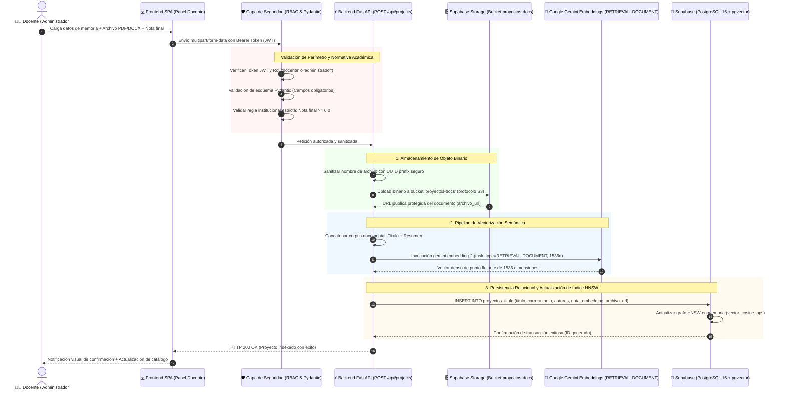
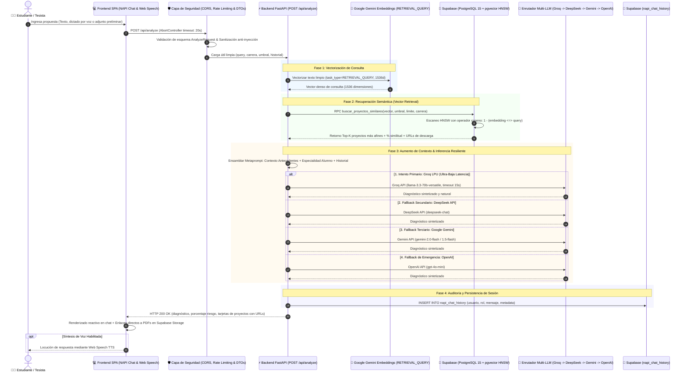
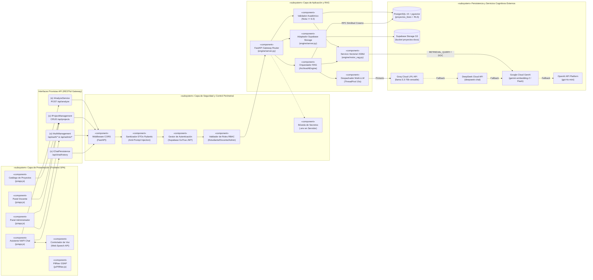
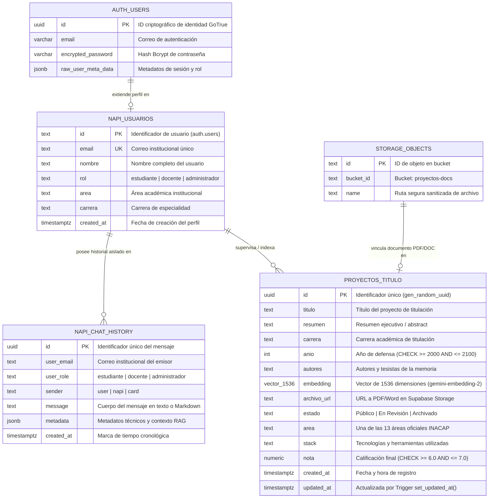
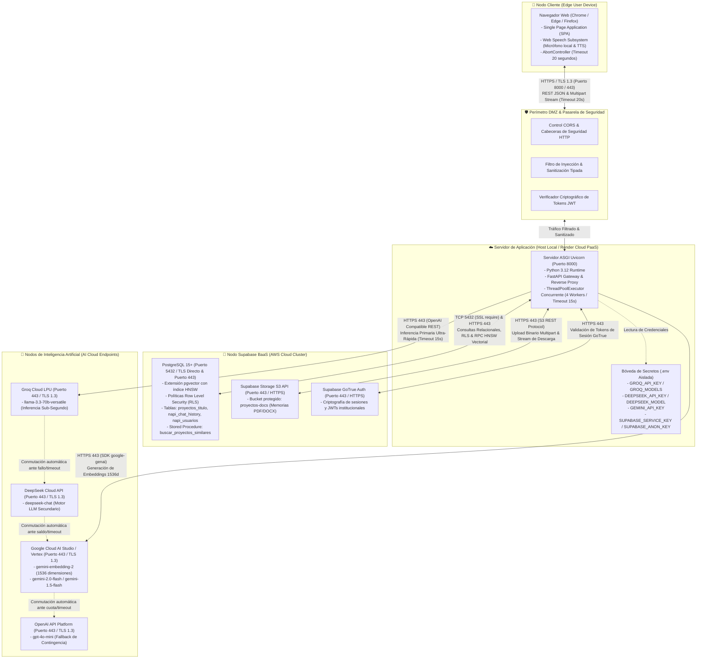
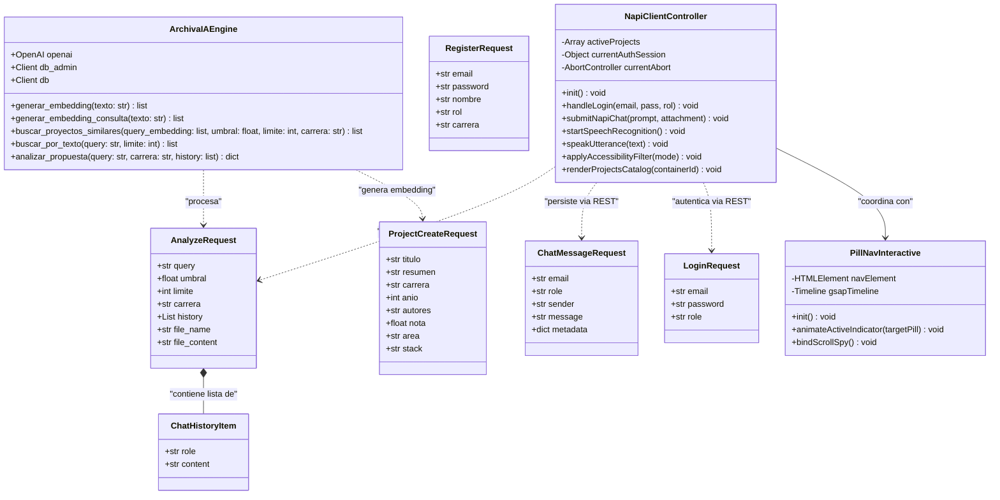

# N.A.P.I — Repositorio Inteligente y Asistente RAG para Proyectos de Título
### *Núcleo Académico de Proyectos e Innovación · INACAP Sede Maipú (2026)*

[](https://www.inacap.cl)
[](https://www.python.org/)
[](https://fastapi.tiangolo.com/)
[](https://ai.google.dev/)
[](https://supabase.com/)
[](#)

---

## 📋 Resumen del Proyecto (Abstract)

En el ámbito de la educación superior técnico-profesional, los proyectos de titulación representan la culminación del ciclo formativo y una fuente invaluable de innovación aplicada. Sin embargo, en instituciones de gran envergadura como **INACAP Sede Maipú**, históricamente gran parte de este conocimiento ha quedado fragmentado en archivos físicos, correos electrónicos o repositorios locales aislados, lo que dificulta su consulta, propicia la duplicidad temática involuntaria y desaprovecha el valor pedagógico del trabajo previo.

**N.A.P.I** (*Núcleo Académico de Proyectos e Innovación*) es una plataforma web integral diseñada para centralizar, preservar, auditar y difundir el acervo de proyectos de título de INACAP Sede Maipú. La solución integra un **Motor RAG (Retrieval-Augmented Generation)** de última generación con **embeddings vectoriales semánticos** y un asistente conversacional interactivo (**NAPI**). A través de esta tecnología, estudiantes y docentes pueden validar ideas de tesis en tiempo real, evaluar porcentajes de similitud respecto al histórico institucional, recibir sugerencias técnicas de diferenciación e innovación adaptadas a su carrera, y gestionar la gobernanza de proyectos bajo estrictos estándares de aprobación académica.

---
## 📐 Patrón Arquitectónico del Sistema: Arquitectura en Capas (Layered / N-Tier Architecture) bajo Modelo Cliente-Servidor

El sistema **N.A.P.I** está estructurado estrictamente bajo el patrón de **Arquitectura en Capas (Layered / N-Tier Architecture)** implementado sobre un modelo **Cliente-Servidor (Client-Server)** desacoplado con integración de servicios cognitivos en la nube (*BaaS* e inferencia Multi-LLM).

### Justificación Teórica y Estructural del Patrón

1. **Separación de Incumbencias (*Separation of Concerns - SoC*):** Cada nivel del sistema posee una responsabilidad única y delimitada. La interfaz de usuario no contiene lógica de negocio ni manipula vectores; la capa de aplicación no renderiza vistas; y la persistencia no toma decisiones de inferencia.
2. **Dependencias Unidireccionales y Capas Cerradas:** Las peticiones fluyen de manera jerárquica de arriba hacia abajo (o hacia capas transversales de infraestructura). Ningún componente inferior tiene conocimiento de la implementación interna de los niveles superiores.
3. **Desacoplamiento Cliente-Servidor (*Decoupled Client-Server*):** El frontend opera como un cliente liviano (*Single Page Application*) que consume servicios de manera asíncrona mediante contratos de interfaz bien definidos (**RESTful APIs** sobre HTTPS/TLS 1.3), lo que permite evolucionar o sustituir la interfaz gráfica sin impactar la lógica del servidor ni la base de datos.
4. **Seguridad y Perímetro Transversal:** Se implementa una capa perimetral y de seguridad obligatoria entre la presentación y la aplicación, garantizando que ninguna transacción acceda a los recursos internos sin autenticación previa, validación de tipos, autorización de roles (**RBAC**) y políticas a nivel de fila (**RLS**).

```
┌────────────────────────────────────────────────────────────────────────────────────────┐
│  TIER 1: CAPA DE PRESENTACIÓN (SPA HTML5 / CSS3 / Accesibilidad CVD y Voz)             │
│  • Menu_Estudiante            • Menu_Docente                                           │
│  • Menu_gestion de proyectos  • Menu_Creacion de usuarios                              │
└───────────────────────────────────────────┬────────────────────────────────────────────┘
                                            │ Req: HTTPS POST/GET (JSON/Multipart, Bearer JWT)
                                            │ Res: JSON (Status, JWT, Diagnóstico) [AbortController 20s]
┌───────────────────────────────────────────▼────────────────────────────────────────────┐
│  TIER 2: SEGURIDAD PERIMETRAL Y ACCESO (Security & Gateway Tier)                       │
│  • Reverse Proxy / SSL (TLS 1.3)   • Gestor de Secretos en Memoria (.env Vault)        │
│  • SolicitudAcceso (Sesiones, Validación JWT, RBAC, Rate Limiting)                     │
└───────────────────────────────────────────┬────────────────────────────────────────────┘
                                            │ Req: Peticiones validadas con UserContext
             ┌──────────────────────────────┴──────────────────────────────┐
             │                                                             │
┌────────────▼───────────────────────────────────────────┐ ┌───────────────▼────────────────────────────┐
│ TIER 3: NEGOCIO Y APLICACIÓN (Domain Tier - FastAPI)   │ │ TIER 4: INTELIGENCIA Y MOTOR RAG            │
│ • Proyecto (/api/projects, metadata, upload)           │ │ (RAG Engine Tier)                           │
│ • Evaluacion (Validación institucional Nota >= 6.0)    │ │ • AsistenteIA (Orquestador RAG)             │
└────────────────────────────┬───────────────────────────┘ │ • VectorEmbedding (gemini-embedding-2 1536d)│
                             │ Upload S3 / Insert DDL      └───────────────┬─────────────────────────────┘
                             │                             ┌───────────────┘ RPC HNSW Coseno
┌────────────────────────────▼─────────────────────────────▼─────────────────────────────┐
│ TIER 5: PERSISTENCIA CLOUD (Data Tier - BaseDatos_Supabase)                            │
│ • PostgreSQL 15+ & pgvector (Índice HNSW Coseno para VectorEmbedding)                 │
│ • Supabase Storage (Bucket proyectos-docs para componente Proyecto)                    │
│ • Supabase Auth & Tablas Relacionales (Para SolicitudAcceso e historial de chat)       │
└──────────────────────────────────────────────────────────┬─────────────────────────────┘
                                                           │
┌──────────────────────────────────────────────────────────▼─────────────────────────────┐
│ BLOQUE TRANSVERSAL: SERVICIOS COGNITIVOS EXTERNOS (Multi-LLM Fallback)                 │
│ • Intento 1: DeepSeek API (deepseek-chat) [Timeout 15s]                                │
│ • Intento 2: Google Cloud Gemini Flash (2.0 / 1.5) [Fallback Secuencial]               │
│ • Intento 3: OpenAI Platform API (gpt-4o-mini) [Fallback Final]                        │
└────────────────────────────────────────────────────────────────────────────────────────┘
```

---

## 🔄 Flujos de Información Bidireccionales: Ingestión (Subida) y Consulta RAG (Bajada)

El sistema procesa información en dos sentidos fundamentales:
1. **Flujo de Subida / Ingestión (*Upstream Data Flow*):** Incorporación, validación, almacenamiento binario e indexación vectorial de tesis aprobadas.
2. **Flujo de Bajada / Consulta y Recuperación (*Downstream Data Flow*):** Vectorización de dudas de alumnos, búsqueda semántica top-K en base de datos, aumento de contexto, inferencia LLM y entrega diagnóstica enriquecida.

---

### A. Flujo de Subida de Información (Upstream: Ingestión, Almacenamiento e Indexación)

Este flujo es ejecutado exclusivamente por usuarios autorizados (**Docentes** o **Administradores**) para preservar la integridad del acervo académico.



#### Detalle Técnico del Flujo de Subida:
1. **Control de Acceso y Filtro Académico:** La Capa de Seguridad intercepta la petición. Si el rol no cuenta con privilegios de edición o si la calificación final del proyecto es inferior a **6.0** ($\text{nota} < 6.0$), la petición es rechazada de inmediato con `HTTP 400 Bad Request` sin consumir recursos de inferencia ni de base de datos.
2. **Sanitización y Persistencia de Archivos:** El documento (PDF o DOCX) se procesa en memoria mediante streams asíncronos (`await file_item.read()`), se le asigna un nombre criptográfico único para evitar colisiones de rutas y se deposita en el bucket seguro `proyectos-docs` de Supabase Storage.
3. **Generación de Embeddings Documentales:** Se invoca el modelo `gemini-embedding-2` con la etiqueta explícita `RETRIEVAL_DOCUMENT`. Esto entrena la representación latente del documento para responder a consultas formuladas en lenguaje natural.
4. **Indexación Atómica en `pgvector`:** El vector resultante de 1536 dimensiones se almacena en la columna tipo `vector(1536)`, actualizando en tiempo real el índice **HNSW** (`m=16, ef_construction=64`) para su consulta inmediata en milisegundos.

---

### B. Flujo de Bajada de Información (Downstream: Consulta, Búsqueda RAG y Generación)

Este flujo representa la interacción del estudiante con el asistente conversacional **NAPI** para evaluar propuestas de titulación y recibir orientación personalizada.



#### Detalle Técnico del Flujo de Bajada:
1. **Captura Resiliente en el Cliente:** La petición se emite con un `AbortController` fijado en 20 segundos para neutralizar arranques en frío de servidores cloud sin colgar la interfaz del estudiante.
2. **Generación de Embeddings de Búsqueda:** La consulta se envía a `gemini-embedding-2` con la directiva `task_type="RETRIEVAL_QUERY"`, alineando el espacio vectorial con los documentos previamente indexados.
3. **Búsqueda Vectorial por Coseno:** La función RPC `buscar_proyectos_similares` consulta el índice HNSW sobre `proyectos_titulo`. La métrica de similitud se calcula matemáticamente como:
   $$\text{Similitud} = 1 - (\vec{u} \cdot \vec{v}) / (\|\vec{u}\| \|\vec{v}\|)$$
4. **Clasificación de Riesgo de Duplicidad:**
   - 🟢 **Sin Riesgo (< 45%):** Propuesta original dentro de la sede.
   - 🟡 **Moderado (45% – 64%):** Coincidencias temáticas; NAPI sugiere vías de innovación técnica específicas.
   - 🟠 **Alto (65% – 79%):** Similitud marcada; se exigen metodologías o herramientas diferenciadoras.
   - 🔴 **Crítico ($\ge 80\%$):** Alta probabilidad de duplicidad temática involuntaria con tesis aprobadas.
5. **Cascada de Inferencia Multi-Proveedor:** Se emplea un `ThreadPoolExecutor` con **timeout estricto de 15 segundos** despachando en cascada:
   - **Nivel 1 (Primario):** **Groq Cloud LPU** (`llama-3.3-70b-versatile` / `openai/gpt-oss-120b`), entregando respuestas en menos de 1 segundo sin coste.
   - **Nivel 2 (Secundario):** **DeepSeek Cloud API** (`deepseek-chat`), para razonamiento profundo si Groq no responde.
   - **Nivel 3 (Terciario):** **Google Gemini Flash** (`gemini-2.0-flash` / `gemini-1.5-flash`).
   - **Nivel 4 (Contingencia):** **OpenAI** (`gpt-4o-mini`).
6. **Descarga de Documentación:** Las tarjetas generadas en el chat incluyen hipervínculos directos a los archivos originales alojados en Supabase Storage, permitiendo al estudiante revisar las memorias de título antecedentes con un solo clic.

---

## 🎯 Objetivos de la Memoria / Tesis

### Objetivo General
Desarrollar e implementar una plataforma web institucional que integre un repositorio digital de proyectos de titulación y un asistente virtual basado en IA y Recuperación Aumentada por Generación (RAG), optimizando la visibilidad, gobernanza y originalidad de las propuestas académicas en INACAP Sede Maipú.

### Objetivos Específicos
1. **Centralizar y categorizar el histórico de proyectos** aprobados en las 13 áreas académicas oficiales de INACAP.
2. **Implementar una arquitectura de búsqueda semántica vectorial** utilizando modelos de lenguaje de gran escala (LLM) y la extensión `pgvector` sobre PostgreSQL.
3. **Construir el agente conversacional NAPI**, capaz de interactuar en lenguaje natural, evaluar memorias y propuestas técnicas, calcular similitud porcentual y orientar la diferenciación metodológica según la carrera del alumno.
4. **Diseñar un sistema de control de accesos basado en roles (RBAC)** con flujos especializados para Estudiantes, Docentes y Administradores.
5. **Incorporar estándares de diseño y accesibilidad universal**, incluyendo navegación interactiva moderna (PillNav), modos de alto contraste y soporte de visión para daltonismo (CVD).

---

## 🏛️ 1. Diagrama de Arquitectura Global (C4 Nivel 2: Contenedores / Enterprise Layering)

El sistema implementa una **Arquitectura en 5 Tiers + Bloque Transversal de Servicios Cognitivos**, resolviendo formalmente la separación perimetral entre la **Capa de Seguridad / Gateway** y la **Capa de Negocio y Aplicación**, además de estandarizar los contratos de flujo de datos (Request / Response):

```mermaid
graph TB
    %% Paleta Dark Mode Enterprise Architect
    classDef actorStyle fill:#1e293b,stroke:#38bdf8,stroke-width:2px,color:#f8fafc;
    classDef t1Style fill:#0f172a,stroke:#3b82f6,stroke-width:2px,color:#f8fafc;
    classDef t2Style fill:#2e1065,stroke:#a855f7,stroke-width:2px,color:#ffffff;
    classDef t3Style fill:#0369a1,stroke:#0284c7,stroke-width:2px,color:#ffffff;
    classDef t4Style fill:#3730a3,stroke:#6366f1,stroke-width:2px,color:#ffffff;
    classDef t5Style fill:#064e3b,stroke:#10b981,stroke-width:2px,color:#ffffff;
    classDef extStyle fill:#701a75,stroke:#ec4899,stroke-width:2px,color:#ffffff;

    %% 1. ACTORES DEL NEGOCIO (NOMENCLATURA EXACTA DE EA)
    subgraph Actors ["👥 Actores del Negocio (Enterprise Architect)"]
        Actor_Estudiante["👨‍🎓 Estudiante (Tesista)\n(Consulta viabilidad, originalidad y RAG)"]:::actorStyle
        Actor_Docente["👨‍🏫 Docente (Comisión Evaluadora)\n(Carga de proyectos y revisión de evaluaciones)"]:::actorStyle
        Actor_Admin["👩‍💼 Administrador/CRAI (Jefa de Biblioteca / Admin)\n(Gestión administrativa institucional y auditoría)"]:::actorStyle
    end

    %% 2. TIER 1: CAPA DE PRESENTACIÓN (SPA)
    subgraph Tier1 ["«layer» Tier 1: Capa de Presentación (Presentation Tier - SPA)"]
        SPA_Portal["«container» Portal Web SPA\n(HTML5 Semántico + Accesibilidad CVD + Web Speech Voz)"]:::t1Style
        Menu_Estudiante["«component» Menu_Estudiante\n(Chat de consulta semántica, viabilidad)"]:::t1Style
        Menu_Docente["«component» Menu_Docente\n(Carga de proyectos, revisión de evaluaciones)"]:::t1Style
        Menu_Gestion["«component» Menu_gestion de proyectos\n(Búsqueda y visualización de catálogo)"]:::t1Style
        Menu_Usuarios["«component» Menu_Creacion de usuarios\n(Gestión administrativa institucional)"]:::t1Style
    end

    %% 3. TIER 2: CAPA DE SEGURIDAD PERIMETRAL Y ACCESO
    subgraph Tier2 ["«layer» Tier 2: Capa de Seguridad Perimetral y Acceso (Security & Gateway Tier)"]
        GW_ReverseProxy["«container» Reverse Proxy / SSL Termination\n(HTTPS / TLS 1.3)"]:::t2Style
        GW_SolicitudAcceso["«component» SolicitudAcceso\n(Manejo de sesiones, validación criptográfica JWTs, control RBAC & Rate Limiting)"]:::t2Style
        GW_SecretVault["«component» Gestor de Secretos en Memoria\n(Bóveda protegida de API Keys para LLMs)"]:::t2Style
    end

    %% 4. TIER 3: CAPA DE NEGOCIO Y APLICACIÓN
    subgraph Tier3 ["«layer» Tier 3: Capa de Negocio y Aplicación (Application & Domain Tier - FastAPI)"]
        COMP_Proyecto["«component» Proyecto\n(Lógica de gestión de memorias, metadatos y endpoints FastAPI /api/projects)"]:::t3Style
        COMP_Evaluacion["«component» Evaluacion\n(Reglas institucionales de validación y filtro Nota >= 6.0)"]:::t3Style
    end

    %% 5. TIER 4: CAPA DE INTELIGENCIA Y MOTOR RAG
    subgraph Tier4 ["«layer» Tier 4: Capa de Inteligencia y Motor RAG (RAG Engine Tier)"]
        COMP_AsistenteIA["«component» AsistenteIA\n(Orquestador RAG: atiende peticiones de Menu_Estudiante y Menu_Docente)"]:::t4Style
        COMP_VectorEmbedding["«component» VectorEmbedding\n(Generación de vectores 1536d gemini-embedding-2 & Despacho concurrente 15s)"]:::t4Style
    end

    %% 6. TIER 5: CAPA DE PERSISTENCIA CLOUD
    subgraph Tier5 ["«layer» Tier 5: Capa de Persistencia Cloud (Data Tier - Supabase BaaS)"]
        subgraph BaseDatos_Supabase ["«component» BaseDatos_Supabase"]
            DB_PGVector[("«database» PostgreSQL 15+ & pgvector\n(Índice HNSW Coseno para VectorEmbedding)")]:::t5Style
            DB_Storage[("«storage» Supabase Storage\n(Bucket proyectos-docs para componente Proyecto)")]:::t5Style
            DB_AuthRelational[("«database» Supabase Auth & Tablas Relacionales\n(Para SolicitudAcceso e historial de chat)")]:::t5Style
        end
    end

    %% 7. BLOQUE TRANSVERSAL: SERVICIOS COGNITIVOS EXTERNOS
    subgraph ExternalTier ["«layer» Bloque Transversal: Servicios Cognitivos Externos (Multi-LLM Inference)"]
        EXT_DeepSeek["«external» DeepSeek API (deepseek-chat)\n(Motor Principal de Razonamiento - Intento 1)"]:::extStyle
        EXT_GeminiFlash["«external» Google Cloud Gemini Flash (2.0 / 1.5)\n(Motor Secundario de Alta Concurrencia - Intento 2)"]:::extStyle
        EXT_OpenAI["«external» OpenAI Platform API (gpt-4o-mini)\n(Fallback Final de Contingencia - Intento 3)"]:::extStyle
    end

    %% INTERACCIÓN ACTORES -> INTERFACES DE PRESENTACIÓN
    Actor_Estudiante -->|"Interactúa con consultas"| Menu_Estudiante
    Actor_Estudiante -->|"Explora catálogo"| Menu_Gestion
    Actor_Docente -->|"Carga y evalúa memorias"| Menu_Docente
    Actor_Docente -->|"Consulta proyectos"| Menu_Gestion
    Actor_Admin -->|"Administra usuarios y permisos"| Menu_Usuarios
    Actor_Admin -->|"Auditoría de catálogo"| Menu_Gestion

    SPA_Portal -.->|"Contenedor base & soporte CVD / voz"| Menu_Estudiante
    SPA_Portal -.->|"Contenedor base & soporte CVD / voz"| Menu_Docente
    SPA_Portal -.->|"Contenedor base & soporte CVD / voz"| Menu_Gestion
    SPA_Portal -.->|"Contenedor base & soporte CVD / voz"| Menu_Usuarios

    %% FLUJO 1: PRESENTACIÓN (TIER 1) -> PERÍMETRO (TIER 2)
    Menu_Estudiante -->|"Req: Consulta semántica (JSON + Bearer JWT)"| GW_ReverseProxy
    Menu_Docente -->|"Req: Upload memoria / consulta (Multipart/JSON + Bearer JWT)"| GW_ReverseProxy
    Menu_Gestion -->|"Req: Búsqueda / consulta catálogo (GET /api/projects)"| GW_ReverseProxy
    Menu_Usuarios -->|"Req: Gestión administrativa (POST/GET /api/admin/users)"| GW_ReverseProxy

    GW_ReverseProxy -->|"Tráfico TLS 1.3 / Enrutamiento perimetral"| GW_SolicitudAcceso
    GW_SolicitudAcceso -.->|"Carga protegida de llaves maestras"| GW_SecretVault
    GW_SolicitudAcceso <-->|"Validación de tokens JWT y sesiones criptográficas"| DB_AuthRelational
    GW_ReverseProxy -->|"Res: JSON / diagnóstico sintetizado [AbortController 20s]"| SPA_Portal

    %% FLUJO 2: SEGURIDAD (TIER 2) -> COMUNICACIÓN CON ASISTENTEIA, PROYECTO Y USUARIOS
    %% Requisito 8: Menu_Estudiante y Menu_Docente se comunican con AsistenteIA a través de SolicitudAcceso
    GW_SolicitudAcceso -->|"Req: Peticiones de Menu_Estudiante y Menu_Docente (UserContext verificado)"| COMP_AsistenteIA
    GW_SolicitudAcceso -->|"Req: Gestión de memorias y catálogo (/api/projects)"| COMP_Proyecto
    GW_SolicitudAcceso -->|"Req: Registro y administración de usuarios"| DB_AuthRelational

    %% FLUJO 3: CAPA DE NEGOCIO Y APLICACIÓN (TIER 3)
    COMP_Proyecto <-->|"Valida regla institucional (Nota >= 6.0)"| COMP_Evaluacion
    COMP_Proyecto -->|"Req: Indexación de proyecto aprobado (Vectorización)"| COMP_VectorEmbedding
    COMP_Proyecto -->|"Req: Subida binaria multipart de memoria PDF/DOCX"| DB_Storage
    DB_Storage -->|"Res: Storage URL firmada del archivo"| COMP_Proyecto
    COMP_Proyecto -->|"Req: Persistencia de registro y metadatos"| DB_PGVector

    %% FLUJO 4: CAPA DE INTELIGENCIA Y MOTOR RAG (TIER 4)
    COMP_AsistenteIA -->|"1. Req: Generación de embedding de consulta (1536d)"| COMP_VectorEmbedding
    COMP_VectorEmbedding -->|"Invocación gemini-embedding-2"| EXT_GeminiFlash
    COMP_VectorEmbedding -->|"Res: Vector denso normalizado (1536d)"| COMP_AsistenteIA

    COMP_AsistenteIA -->|"2. Req: RPC buscar_proyectos_similares (Filtro Coseno HNSW)"| DB_PGVector
    DB_PGVector -->|"Res: Top-K fragmentos y metadatos relevantes"| COMP_AsistenteIA

    COMP_AsistenteIA -->|"3. Persistencia de turnos en historial de chat"| DB_AuthRelational

    %% FLUJO 5: CASCADA MULTI-LLM EN FALLBACK SECUENCIAL
    COMP_AsistenteIA -->|"4. Despacho inferencia con metaprompt aumentado (15s timeout)"| EXT_DeepSeek
    EXT_DeepSeek -.->|"Fallback secuencial 1 (latencia > 15s / error)"| EXT_GeminiFlash
    EXT_GeminiFlash -.->|"Fallback secuencial 2 (cuota saturada / error)"| EXT_OpenAI

    COMP_AsistenteIA -->|"Res: Diagnóstico sintetizado + fuentes citadas"| GW_SolicitudAcceso
```



**Aspectos Clave de la Arquitectura Refactorizada:**
- **Separación Gateway / Lógica de Negocio:** El Tier 2 (`Security & Gateway Tier`) a través de `SolicitudAcceso` asume de manera exclusiva la terminación TLS, el control RBAC, rate limiting, la sanitización anti-inyección y la validación criptográfica de JWTs; el Tier 3 (`Application & Domain Tier`) se enfoca puramente en las reglas de negocio institucionales con `Proyecto` y el filtro estricto de `Evaluacion` (Nota $\ge 6.0$).
- **Definición Formal de Conectores:** Todas las interfaces provistas y requeridas están tipadas con esquemas Request/Response legibles (`HTTPS/TLS 1.3`, `In-process ASGI`, `S3 REST`, `pgvector RPC`) y políticas de resiliencia (`AbortController 20s`, `ThreadPool 15s`).
- **Comunicación Directa a AsistenteIA:** Tanto `Menu_Estudiante` como `Menu_Docente` se comunican con `AsistenteIA` a través del Gateway (`SolicitudAcceso`) para consultas semánticas, viabilidad y evaluaciones.
- **Cascada de Inferencia Multi-LLM en Fallback Secuencial:** Enrutamiento resiliente que prioriza **DeepSeek API** por consistencia pedagógica y profundidad técnica, conmutando ordenadamente a **Google Cloud Gemini Flash** y **OpenAI Platform API** ante saturaciones o expiración de timeouts.
- **Persistencia Cloud Integral (BaseDatos_Supabase):** Subdividida formalmente en PostgreSQL 15+ & pgvector (índice HNSW Coseno), Supabase Storage (bucket `proyectos-docs`) y Supabase Auth & tablas relacionales.

---
## 🧩 2. Diagrama de Componentes (UML 2.5 Component Specification)

Modela los subsistemas modulares de software, la capa perimetral de seguridad, sus interfaces provistas (endpoints REST) y sus interfaces requeridas:



**Interfaces y Componentes Clave:**
- `IAnalyzeService`: Recibe la propuesta de título, especialidad y adjunto preliminar; ejecuta sanitización, vectorización semántica, búsqueda cosenoidal y generación multimodelo.
- `IProjectManagement`: Controla altas, bajas y modificaciones de memorias de título, validando obligatoriamente que `nota >= 6.0` y subiendo documentos a Supabase Storage.
- `IChatPersistence`: Almacena y recupera el historial garantizando aislamiento por usuario y rol en Supabase.
- `SecurityComponents`: Centralizan el control perimetral mediante CORS, autenticación JWT GoTrue, autorización RBAC y sanitización tipada con Pydantic contra ataques de inyección de código o prompts.

---

## 📊 3. Modelo de Datos (Relational & Vectorial ERD Specification)

Diagrama Entidad-Relación en **Notación Crow's Foot** que integra el esquema relacional con la capa vectorial de `pgvector`:



**Especificación Técnica del Almacén Vectorial:**
- **Dimensión Óptima (1536 dims):** Se utiliza `gemini-embedding-2` con `output_dimensionality = 1536`. Esto garantiza la máxima fidelidad semántica manteniéndose estrictamente por debajo del límite de 2000 dimensiones impuesto por los índices HNSW de `pgvector`.
- **Índice HNSW:**
  ```sql
  CREATE INDEX idx_proyectos_embedding_hnsw
    ON public.proyectos_titulo
    USING hnsw (embedding vector_cosine_ops)
    WITH (m = 16, ef_construction = 64);
  ```
- **Procedimiento Almacenado RPC:** `public.buscar_proyectos_similares(query_embedding vector(1536), match_threshold float, match_count int, filtro_carrera text)` calcula la similitud mediante el operador de distancia coseno `1 - (p.embedding <=> query_embedding)`.

---

## 🌐 4. Topología de Comunicación, Red y DMZ (Deployment & Protocols)

Describe los nodos computacionales, fronteras de seguridad (**DMZ**), canales de transporte, protocolos y puertos involucrados:



**Matriz de Comunicaciones y Seguridad:**
| Canal | Protocolo | Puerto | Payload / Contenido | Autenticación | SLA / Timeout |
| :--- | :--- | :---: | :--- | :--- | :---: |
| **Cliente $\to$ FastAPI** | HTTPS / TLS 1.3 | `443` / `8000` | JSON / Multipart Form-Data | JWT / Sesión | 20s (`AbortController`) |
| **FastAPI $\to$ PostgreSQL** | Direct TCP / SSL | `5432` | Protocolo Binario pgvector / RPC | `service_role` | < 100 ms |
| **FastAPI $\to$ Supabase Storage** | HTTPS S3 REST | `443` | Stream Binario (PDF / DOCX) | `service_role` Secret | 10s |
| **FastAPI $\to$ Google AI** | HTTPS / gRPC | `443` | Vectorización 1536d | `GEMINI_API_KEY` | 3s |
| **FastAPI $\to$ Groq Cloud** | HTTPS REST | `443` | Chat Completions (Llama 3.3 70B) | `GROQ_API_KEY` | 15s (`ThreadPool`) |
| **FastAPI $\to$ DeepSeek** | HTTPS REST | `443` | Chat Completions | `DEEPSEEK_API_KEY` | 15s (`ThreadPool`) |
| **FastAPI $\to$ OpenAI** | HTTPS REST | `443` | Chat Completions (gpt-4o-mini) | `OPENAI_API_KEY` | 12s |

---

## 🏗️ 5. Diagrama de Estructura y Clases (Composite Structure & Class Hierarchy)

Modela la jerarquía de paquetes del sistema, las clases del motor RAG, los modelos de validación Pydantic y los controladores de cliente:



**Detalle de Módulos y Clases:**
- **`ArchivaIAEngine` (`engine/motor_rag.py`):** Encapsula la generación de tensores de 1536 dimensiones, la invocación de la función RPC `buscar_proyectos_similares` en Supabase y el fallback léxico por texto.
- **DTOs Pydantic (`engine/server.py`):** `AnalyzeRequest`, `ProjectCreateRequest`, `ChatMessageRequest`, etc., aseguran tipificación fuerte y sanitización en tiempo de ejecución.
- **`NapiClientController` (`js/app.js`):** Gestiona el estado de la SPA, la interacción por voz con la Web Speech API, los filtros de daltonismo CVD y el renderizado dinámico de tarjetas y diagnósticos.
- **`PillNavInteractive` (`js/PillNav.js`):** Controlador de navegación flotante animado mediante **GSAP**.

---

---

## 🛠️ Tecnologías Empleadas

### **Frontend (Capa de Presentación)**
- **HTML5 & CSS3 Vanilla:** Estructura semántica, diseño responsivo, CSS Variables, glassmorphism y paleta corporativa moderna.
- **JavaScript Moderno (ES6+):** Programación reactiva modular (`app.js`, `PillNav.js`), manipulación directa del DOM sin sobrecarga de dependencias, gestión de llamadas asíncronas con `AbortController` (timeout 20s).
- **Web Speech API:** Reconocimiento de voz por micrófono y síntesis de voz (Text-to-Speech) integrado en el asistente.
- **GSAP (GreenSock):** Micro-animaciones para el componente de navegación flotante (`PillNav`).

### **Capa de Seguridad, Identidad & Perímetro**
- **Supabase Auth (GoTrue):** Emisión y validación criptográfica de JSON Web Tokens (JWT) con firma asimétrica para sesiones de usuario.
- **Control de Acceso RBAC (Role-Based Access Control):** Separación estricta de privilegios entre Estudiantes, Docentes y Administradores.
- **PostgreSQL Row Level Security (RLS):** Aislamiento de consultas y modificaciones en base de datos a nivel de registro.
- **FastAPI CORS Middleware:** Reglas de origen cruzado para despliegues locales y cloud.
- **Pydantic V2:** Validación estricta y sanitización de esquemas tipados en tiempo de ejecución (defensa contra Prompt Injection y XSS).
- **Aislamiento de Entorno (.env Vault):** Almacenamiento perimetral en servidor de todas las llaves maestras sin exposición al cliente.

### **Backend & Motor RAG (Capa de Aplicación)**
- **Python 3.12 & FastAPI:** Framework asíncrono ASGI de alto rendimiento para exponer la API RESTful.
- **Uvicorn:** Servidor ASGI para ejecución productiva y desarrollo continuo.
- **ThreadPoolExecutor Concurrente:** Despacho multi-hilo con control estricto de timeouts (15s) para orquestar llamadas concurrentes a modelos LLM.
- **ArchivaIAEngine:** Orquestador RAG personalizado para cálculo de tensores, indexación y similitud semántica.

### **Inteligencia Artificial & Persistencia Cloud**
- **Groq Cloud LPU API:** Motor LLM primario de ultra-alta velocidad (`llama-3.3-70b-versatile`, `openai/gpt-oss-120b`).
- **DeepSeek Cloud API:** Motor LLM secundario para razonamiento profundo (`deepseek-chat`).
- **Google GenAI SDK (`google-genai`):** Embeddings semánticos normalizados de 1536 dimensiones (`gemini-embedding-2`) e inferencia con `gemini-2.0-flash` y `gemini-1.5-flash`.
- **OpenAI Platform API:** Motor de respaldo terciario (`gpt-4o-mini`).
- **Supabase (PostgreSQL 15+ & pgvector):** Motor relacional y vectorial con índice HNSW (`vector_cosine_ops`), RPCs de búsqueda y Storage S3 (`proyectos-docs`).

---

## 🚀 Instalación y Despliegue Local

### 1. Clonar el Repositorio
```bash
git clone https://github.com/MemoryTesis2026/N.A.P.I.git
cd N.A.P.I
```

### 2. Configurar el Entorno Virtual de Python
```bash
# Crear entorno virtual
python -m venv .venv

# Activar en Windows
.venv\Scripts\activate

# Instalar dependencias del backend
pip install -r engine/requirements.txt
```

### 3. Configurar Variables de Entorno (`.env`)
Crear un archivo `.env` dentro de la carpeta `engine/` o en la raíz del proyecto:
```env
# Proveedores de Inteligencia Artificial (Inferencia & Embeddings)
GROQ_API_KEY=tu_api_key_de_groq_cloud
GROQ_MODEL=llama-3.3-70b-versatile,openai/gpt-oss-120b
DEEPSEEK_API_KEY=tu_api_key_de_deepseek_opcional
DEEPSEEK_MODEL=deepseek-chat
GEMINI_API_KEY=tu_api_key_de_google_ai_studio
OPENAI_API_KEY=tu_api_key_de_openai_opcional

# Persistencia y Autenticación en Supabase
SUPABASE_URL=https://tu-proyecto.supabase.co
SUPABASE_SERVICE_KEY=tu_service_role_key_supabase
SUPABASE_ANON_KEY=tu_anon_key_supabase
PORT=8000
```

### 4. Configurar la Base de Datos en Supabase
1. Ingresar a la consola de [Supabase](https://supabase.com/).
2. Abrir el **SQL Editor**.
3. Ejecutar el script completo ubicado en [`engine/archivaia_schema_gemini.sql`](file:///c:/Users/franc/OneDrive/Escritorio/Pagina%20de%20N.A.P.I%20celeste/Pagina%20de%20N.A.P.I/engine/archivaia_schema_gemini.sql).
4. Opcional: Ejecutar `python engine/seed_all_projects.py` para cargar los proyectos iniciales con sus respectivos embeddings vectoriales.

### 5. Iniciar la Aplicación
#### Opción A (Windows con archivo por lotes):
Hacer doble clic en `iniciar_servidor.bat`.

#### Opción B (Línea de comandos):
```bash
python run_server.py
```
El servidor backend quedará disponible en `http://127.0.0.1:8000` y servirá el frontend automáticamente en la ruta raíz `/`.

---

## 📂 Estructura del Repositorio

```plaintext
N.A.P.I/
├── assets/                     # Recursos gráficos, fotografías del campus y fondos hero
├── css/
│   ├── PillNav.css             # Estilos de navegación flotante interactiva
│   └── styles.css              # Sistema de diseño global, modo oscuro, CVD y layout
├── engine/                     # Núcleo del servidor backend y RAG
│   ├── archivaia_schema_gemini.sql # Esquema DDL de PostgreSQL, pgvector y RPC
│   ├── motor_rag.py            # Clase principal ArchivaIAEngine para embeddings y búsqueda
│   ├── requirements.txt        # Dependencias de Python
│   ├── seed_all_projects.py    # Script de población de datos con vectorización inicial
│   └── server.py               # Servidor FastAPI con endpoints REST y lógica de negocio RAG
├── img/                        # Recursos de respaldo para visualizadores de sedes
├── js/
│   ├── PillNav.js              # Controlador JS del menú de navegación
│   └── app.js                  # Lógica del frontend (autenticación, CRUD, chat RAG, voz, timeouts)
├── src/                        # Componentes fuente reutilizables (JSX / CSS)
├── .gitignore                  # Exclusión de archivos sensibles (.env, cachés, venv)
├── index.html                  # Punto de entrada principal SPA
├── iniciar_servidor.bat        # Acceso directo para ejecución en entornos Windows
├── motor_rag.py                # Wrapper de ejecución rápida desde raíz
├── README.md                   # Documentación académica e integral del proyecto de título
└── run_server.py               # Lanzador principal ASGI con Uvicorn
```

---

## 🔒 Capa de Seguridad Integral y Ética de la Información

La seguridad y la confidencialidad constituyen un requerimiento no funcional de primer orden en N.A.P.I. Se implementan siete pilares formales de protección:

1. **Aislamiento Perimetral y Bóveda de Credenciales:** Todas las llaves maestras de API (`GROQ_API_KEY`, `DEEPSEEK_API_KEY`, `GEMINI_API_KEY`, `SUPABASE_SERVICE_KEY`) residen exclusivamente en variables de entorno del servidor. El frontend opera como cliente sin privilegios, consumiendo la API sin visibilidad de secretos de infraestructura.
2. **Autenticación Criptográfica (Supabase Auth / JWT):** La identidad de estudiantes, docentes y administradores es verificada mediante JSON Web Tokens firmados criptográficamente. Las sesiones expiran y se renuevan de acuerdo con los estándares OAuth 2.0 y GoTrue.
3. **Control de Acceso Basado en Roles (RBAC):** Se implementa separación de privilegios a nivel de endpoint:
   - **Estudiante:** Acceso a lectura del catálogo público, formulación de consultas en NAPI Chat y gestión de su propio historial.
   - **Docente:** Carga de memorias de título, validación de notas ($\ge 6.0$), indexación de documentos y acceso a estadísticas académicas.
   - **Administrador:** Gobernanza integral de usuarios, asignación de roles, auditoría transversal y supervisión del repositorio.
4. **Seguridad a Nivel de Fila (PostgreSQL Row Level Security - RLS):** A nivel de motor de base de datos, las tablas críticas (`proyectos_titulo`, `napi_chat_history`, `napi_usuarios`) aplican políticas RLS, impidiendo que consultas no autorizadas o fallos de aplicación expongan registros ajenos.
5. **Sanitización y Validación Tipada en Tiempo de Ejecución (Pydantic V2):** Toda petición entrante es deserializada y validada por esquemas Pydantic estrictos, neutralizando ataques de inyección SQL, desbordamientos de buffer e inyección de prompts maliciosos (*Jailbreak / Prompt Injection*).
6. **Integridad Académica Institucional:** Cumplimiento estricto del reglamento de titulación de INACAP: el sistema bloquea automáticamente la indexación de cualquier memoria con calificación inferior a **6.0** ($\text{nota} < 6.0$).
7. **Resiliencia Operativa y Mitigación de Denegación de Servicio:** Mecanismos de protección en ambos extremos:
   - **Cliente:** `AbortController` con 20 segundos de tolerancia ante reinicios en frío (*cold starts*) de nubes PaaS.
   - **Backend:** `ThreadPoolExecutor` con timeouts no bloqueantes de 15 segundos y fallback automático en cascada (Groq $\to$ DeepSeek $\to$ Gemini $\to$ OpenAI).

---

## 🎓 Autores y Agradecimientos

- **Desarrollo y Memoria de Título:** Estudiantes de Ingeniería en Informática — INACAP Sede Maipú (2026).
- **Institución:** Universidad Tecnológica de Chile INACAP · Sede Maipú.
- **Docente Guía y Comisión Evaluadora:** Área Tecnologías de la Información y Ciberseguridad.

---
*© 2026 INACAP Sede Maipú · N.A.P.I. Todos los derechos reservados.*