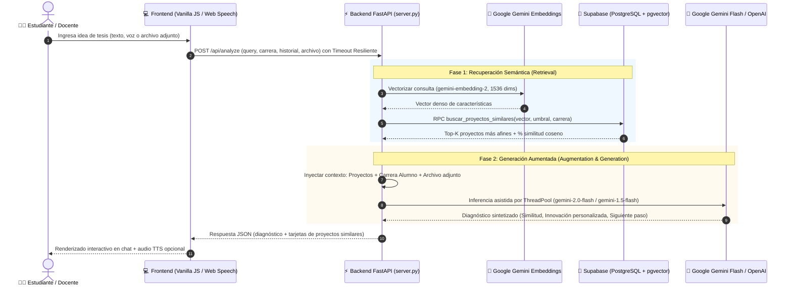
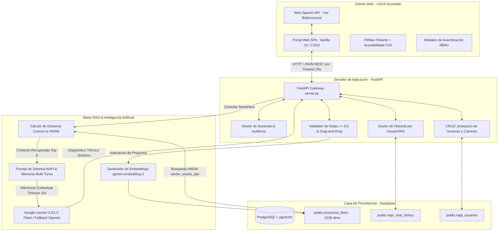

# N.A.P.I — Repositorio Inteligente y Asistente RAG para Proyectos de Título
### *Núcleo Académico de Proyectos e Innovación · INACAP Sede Maipú (2026)*

[](https://www.inacap.cl)
[](https://www.python.org/)
[](https://fastapi.tiangolo.com/)
[](https://ai.google.dev/)
[](https://supabase.com/)
[](#)

---

## 📋 Resumen del Proyecto (Abstract)

En el ámbito de la educación superior técnico-profesional, los proyectos de titulación representan la culminación del ciclo formativo y una fuente invaluable de innovación aplicada. Sin embargo, en instituciones de gran envergadura como **INACAP Sede Maipú**, históricamente gran parte de este conocimiento ha quedado fragmentado en archivos físicos, correos electrónicos o repositorios locales aislados, lo que dificulta su consulta, propicia la duplicidad temática involuntaria y desaprovecha el valor pedagógico del trabajo previo.

**N.A.P.I** (*Núcleo Académico de Proyectos e Innovación*) es una plataforma web integral diseñada para centralizar, preservar, auditar y difundir el acervo de proyectos de título de INACAP Sede Maipú. La solución integra un **Motor RAG (Retrieval-Augmented Generation)** de última generación con **embeddings vectoriales semánticos** y un asistente conversacional interactivo (**NAPI**). A través de esta tecnología, estudiantes y docentes pueden validar ideas de tesis en tiempo real, evaluar porcentajes de similitud respecto al histórico institucional, recibir sugerencias técnicas de diferenciación e innovación adaptadas a su carrera, y gestionar la gobernanza de proyectos bajo estrictos estándares de aprobación académica.

---

## 💡 ¿Cómo Funciona N.A.P.I? (Funcionamiento Integral)

El sistema conecta una interfaz de usuario accesible y moderna con un motor de backend inteligente que combina bases de datos vectoriales e inteligencia artificial generativa. A continuación se desglosan los flujos operativos fundamentales:



---

### 1. El Flujo del Estudiante: Validación de Propuestas en Tiempo Real
1. **Definición de Perfil y Carrera:** El estudiante indica o tiene configurada su carrera o área formativa (por ejemplo, *Ingeniería en Informática*, *Telecomunicaciones*, *Mecánica y Electromovilidad Automotriz*, etc.). Esto es crucial porque la IA no entregará recomendaciones genéricas, sino aterrizadas en las herramientas, normas y enfoques propios de su disciplina.
2. **Ingreso de la Idea:**
   - **Texto directo:** Redacción libre de la problemática o solución planteada.
   - **Documento adjunto:** Carga de anteproyectos preliminares en formato PDF, Word (DOCX) o texto plano (TXT).
   - **Entrada por Voz:** Integración nativa con la **Web Speech API** del navegador, permitiendo dictar la idea cómodamente desde cualquier dispositivo.
3. **Resiliencia en Frontend (`js/app.js`):** La petición se envía con un `AbortController` configurado con **20 segundos de margen**, protegiendo la experiencia de usuario contra arranques en frío (*cold start*) de servidores cloud en capas gratuitas (como Render) y garantizando que el usuario siempre reciba retroalimentación.

---

### 2. El Pipeline del Motor RAG en el Backend (`engine/server.py`)
Cuando la API recibe la petición en el endpoint `/api/analyze`, se ejecuta un proceso en dos etapas:

#### A. Recuperación de Información (Retrieval)
- **Vectorización Semántica:** Se limpia y envía el texto de la consulta al modelo `gemini-embedding-2` de Google Cloud con la configuración `task_type="RETRIEVAL_QUERY"`, obteniendo un vector normalizado de **1536 dimensiones**.
- **Búsqueda Vectorial por Similitud Coseno:** La API invoca la función RPC de PostgreSQL `buscar_proyectos_similares` en Supabase. Gracias al índice **HNSW** (`vector_cosine_ops`), la base de datos compara el vector con miles de proyectos aprobados en milisegundos:
  $$\text{Similitud} = 1 - \text{Distancia Coseno}(\vec{u}, \vec{v})$$
- **Clasificación del Nivel de Riesgo Institucional:**
  - 🟢 **Sin Riesgo (< 45%):** Propuesta altamente original en el contexto de la sede.
  - 🟡 **Moderado (45% – 64%):** Existen antecedentes temáticos; se sugiere enfocar la diferenciación técnica.
  - 🟠 **Alto (65% – 79%):** Coincidencia significativa con proyectos previos; se exige justificación metodológica clara.
  - 🔴 **Crítico ($\ge 80\%$):** Alta probabilidad de duplicidad temática involuntaria con tesis ya aprobadas.
- **Fallback Automático:** Si los servicios vectoriales experimentan micro-cortes, el sistema activa automáticamente un fallback de búsqueda léxica/textual ponderada en PostgreSQL para nunca dejar al alumno sin respuesta.

#### B. Generación Aumentada y Personalizada (Generation)
- **Inyección de Contexto y Carrera:** El sistema construye dinámicamente el prompt inyectando:
  1. Los proyectos más parecidos encontrados en la base de datos (Título, Carrera, Año, Autores y Resumen).
  2. El contexto explícito de la carrera o área del estudiante (`[Área/Carrera del estudiante: ...]`).
  3. El extracto de documentos adjuntos (si existen).
  4. Los últimos turnos del historial conversacional para mantener la memoria del diálogo.
- **Orquestación Concurrente y Gestión de Timeouts:** Para evitar bloqueos, las llamadas a los modelos de lenguaje se procesan mediante un `ThreadPoolExecutor` con **timeout estricto de 15 segundos**. La arquitectura implementa cascada inteligente:
  - Intento principal: `gemini-2.0-flash` (alta velocidad y razonamiento refinado).
  - Segundo intento: `gemini-1.5-flash` (alta tolerancia a latencia).
  - Respaldo final (Fallback): OpenAI `gpt-4o-mini`.
- **Estructura Estricta de la Respuesta NAPI:** El modelo está parametrizado para generar respuestas sintéticas, directas y profesionales en español chileno:
  1. **Grado de Similitud:** Porcentaje exacto y mención de las tesis antecedentes (o declaración explícita de idea 100% original).
  2. **Vías Técnicas de Innovación:** 2 puntos concretos orientados a su especialidad (sensores específicos, arquitecturas, metodologías, algoritmos o frameworks).
  3. **Paso Siguiente:** Llamado a la acción para validar el enfoque refinado con su docente guía de titulación.
- **Preguntas de Seguimiento (Follow-ups):** Si el alumno repregunta (por ejemplo: *"¿qué sensores me recomiendas?"* o *"¿cómo lo hago más innovador?"*), NAPI detecta que es una consulta de profundización y responde de manera puntual y quirúrgica, sin repetir listas de proyectos anteriores.

---

### 3. El Flujo del Docente: Aseguramiento de la Calidad y Aprobación
- **Filtro Académico Riguroso:** Para salvaguardar la excelencia del repositorio, el sistema solo permite indexar proyectos con calificación igual o superior a **6.0 ($\ge 6.0$)**.
- **Carga Rápida (Drag-and-Drop):** Los profesores pueden arrastrar memorias de titulación o completar formularios guiados.
- **Indexación Vectorial Inmediata:** Al guardar un proyecto, el backend genera el vector denso (`RETRIEVAL_DOCUMENT`) y lo almacena transaccionalmente en Supabase, dejándolo inmediatamente disponible para el motor de búsqueda semántica.

---

### 4. El Flujo del Administrador: Gobernanza y Auditoría
- **Gestión Jerárquica de Usuarios:** Altas, bajas y modificaciones de cuentas para estudiantes, docentes y coordinadores.
- **Organización por 13 Áreas INACAP:** Clasificación automática y filtrado según las áreas oficiales institucionales (Administración, Construcción, Informática y Ciberseguridad, Minería, Mecánica, etc.).
- **Auditoría e Historial:** Monitoreo de consultas en `napi_chat_history` para analizar tendencias temáticas de titulación e identificar áreas con baja tasa de innovación.

---

## 🎯 Objetivos de la Memoria / Tesis

### Objetivo General
Desarrollar e implementar una plataforma web institucional que integre un repositorio digital de proyectos de titulación y un asistente virtual basado en IA y Recuperación Aumentada por Generación (RAG), optimizando la visibilidad, gobernanza y originalidad de las propuestas académicas en INACAP Sede Maipú.

### Objetivos Específicos
1. **Centralizar y categorizar el histórico de proyectos** aprobados en las 13 áreas académicas oficiales de INACAP.
2. **Implementar una arquitectura de búsqueda semántica vectorial** utilizando modelos de lenguaje de gran escala (LLM) y la extensión `pgvector` sobre PostgreSQL.
3. **Construir el agente conversacional NAPI**, capaz de interactuar en lenguaje natural, evaluar memorias y propuestas técnicas, calcular similitud porcentual y orientar la diferenciación metodológica según la carrera del alumno.
4. **Diseñar un sistema de control de accesos basado en roles (RBAC)** con flujos especializados para Estudiantes, Docentes y Administradores.
5. **Incorporar estándares de diseño y accesibilidad universal**, incluyendo navegación interactiva moderna (PillNav), modos de alto contraste y soporte de visión para daltonismo (CVD).

---

## 🏗️ Arquitectura Técnica del Sistema

El sistema implementa una arquitectura desacoplada y orientada a servicios, optimizada para baja latencia, resiliencia y alta precisión en la recuperación de información.



> 📚 **Suite Completa de Arquitectura Enterprise (Estándar Sparx EA / TOGAF / C4 / UML 2.5):**  
> Para una revisión técnica profunda y especificaciones formales de ingeniería de software, consulte el directorio especializado [`docs/arquitectura/`](docs/arquitectura/README.md):
> - [🏛️ **01. Diagrama de Arquitectura Global** (C4 Containers & Enterprise Layering)](docs/arquitectura/01_diagrama_arquitectura.md)
> - [🧩 **02. Diagrama de Componentes** (UML 2.5 Component Specification)](docs/arquitectura/02_diagrama_componentes.md)
> - [📊 **03. Modelo de Datos** (Relational & Vectorial ERD + HNSW 1536d)](docs/arquitectura/03_modelo_datos.md)
> - [🌐 **04. Topología de Comunicación y Red** (Deployment & Protocols Matrix)](docs/arquitectura/04_topologia_comunicacion.md)
> - [🏗️ **05. Diagrama de Estructura y Clases** (Packages, Composite Structure & DTOs)](docs/arquitectura/05_diagrama_estructura.md)

---

## 👥 Módulos Funcionales y Control de Accesos (RBAC)

| Módulo | Perfil de Acceso | Descripción Funcional |
| :--- | :--- | :--- |
| **Landing & Catálogo Público** | Libre / Estudiantes | Exploración de proyectos aprobados, filtrado por carrera/año/área, visualización de fichas técnicas y carrusel institucional interactivo. |
| **Asistente NAPI (Chat & Voz)** | Estudiantes / Docentes | Diagnóstico de originalidad, contextualización por carrera, análisis de archivos adjuntos, memoria conversacional multi-turno y consultas guiadas por voz. |
| **Panel Docente** | Docente / Revisor | Indexación de nuevas tesis, validación obligatoria de calificación ($\ge 6.0$), drag-and-drop de archivos y visualización de métricas de sede. |
| **Panel Administrador** | Administrador | CRUD completo de usuarios (alumnos y profesores), doble filtro jerárquico por Área Académica (13 áreas INACAP) y Carrera, auditoría del repositorio. |
| **Accesibilidad Universal (CVD)** | Todos los usuarios | Selector de temas (Claro / Oscuro) con bordes de alto contraste y simulación de daltonismo: Deuteranopia, Protanopia, Tritanopia y Acromatopsia. |

---

## 📊 Modelo de Datos (PostgreSQL + Supabase)

### 1. Tabla `proyectos_titulo` (Repositorio Vectorial)
```sql
CREATE TABLE public.proyectos_titulo (
  id          UUID        DEFAULT gen_random_uuid() PRIMARY KEY,
  titulo      TEXT        NOT NULL,
  resumen     TEXT        NOT NULL,
  carrera     TEXT        NOT NULL,
  anio        INT         NOT NULL CHECK (anio >= 2000 AND anio <= 2100),
  autores     TEXT        NOT NULL,
  embedding   VECTOR(1536), -- Generado con gemini-embedding-2
  archivo_url TEXT,         -- URL pública del PDF/Word en Supabase Storage (bucket: proyectos-docs)
  created_at  TIMESTAMPTZ DEFAULT NOW(),
  updated_at  TIMESTAMPTZ DEFAULT NOW()
);

-- Si la tabla ya existe, agregar la columna con:
-- ALTER TABLE public.proyectos_titulo ADD COLUMN IF NOT EXISTS archivo_url TEXT;

-- Índice vectorial de alta velocidad
CREATE INDEX idx_proyectos_embedding_hnsw
  ON public.proyectos_titulo
  USING hnsw (embedding vector_cosine_ops)
  WITH (m = 16, ef_construction = 64);
```

### 2. Tabla `napi_chat_history` (Historial Aislado)
```sql
CREATE TABLE public.napi_chat_history (
  id          UUID        DEFAULT gen_random_uuid() PRIMARY KEY,
  user_email  TEXT        NOT NULL,
  user_role   TEXT        NOT NULL DEFAULT 'estudiante',
  sender      TEXT        NOT NULL, -- 'user' | 'napi' | 'card'
  message     TEXT        NOT NULL,
  metadata    JSONB       DEFAULT '{}'::jsonb,
  created_at  TIMESTAMPTZ DEFAULT NOW()
);

CREATE INDEX idx_napi_chat_user 
  ON public.napi_chat_history (user_email, user_role, created_at);
```

---

## 🛠️ Tecnologías Empleadas

### **Frontend**
- **HTML5 & CSS3 Vanilla:** Estructura semántica, diseño responsivo, CSS Variables, glassmorphism y paleta corporativa moderna.
- **JavaScript Moderno (ES6+):** Programación reactiva modular (`app.js`, `PillNav.js`), manipulación de DOM sin sobrecarga de frameworks, gestión de llamadas asíncronas con `AbortController`.
- **Web Speech API:** Reconocimiento de voz por micrófono y síntesis de voz (Text-to-Speech) integrado en el asistente.
- **GSAP (GreenSock):** Micro-animaciones para el componente de navegación flotante (`PillNav`).

### **Backend**
- **Python 3.12 & FastAPI:** Framework asíncrono de alto rendimiento para exponer la API REST de búsqueda, autenticación y chat.
- **Uvicorn:** Servidor ASGI para ejecución en producción y desarrollo.
- **ThreadPoolExecutor:** Gestión concurrente de llamadas a modelos LLM con control de timeouts para evitar bloqueos del hilo principal.
- **Pydantic:** Validación estricta de esquemas de datos y peticiones HTTP.

### **Inteligencia Artificial & Base de Datos**
- **Google GenAI SDK (`google-genai`):** Embeddings de 1536 dimensiones (`gemini-embedding-2`) e inferencia con `gemini-2.0-flash` y `gemini-1.5-flash`.
- **OpenAI API (`openai`):** Motor de respaldo (fallback) con `gpt-4o-mini`.
- **Supabase (PostgreSQL 15+):** Base de datos relacional en la nube con soporte nativo de la extensión `pgvector` y Row Level Security (RLS).

---

## 🚀 Instalación y Despliegue Local

### 1. Clonar el Repositorio
```bash
git clone https://github.com/MemoryTesis2026/N.A.P.I.git
cd N.A.P.I
```

### 2. Configurar el Entorno Virtual de Python
```bash
# Crear entorno virtual
python -m venv .venv

# Activar en Windows
.venv\Scripts\activate

# Instalar dependencias del backend
pip install -r engine/requirements.txt
```

### 3. Configurar Variables de Entorno (`.env`)
Crear un archivo `.env` dentro de la carpeta `engine/` o en la raíz del proyecto:
```env
GEMINI_API_KEY=tu_api_key_de_google_ai_studio
OPENAI_API_KEY=tu_api_key_de_openai_opcional
SUPABASE_URL=https://tu-proyecto.supabase.co
SUPABASE_SERVICE_KEY=tu_service_role_key_supabase
SUPABASE_ANON_KEY=tu_anon_key_supabase
PORT=8000
```

### 4. Configurar la Base de Datos en Supabase
1. Ingresar a la consola de [Supabase](https://supabase.com/).
2. Abrir el **SQL Editor**.
3. Ejecutar el script completo ubicado en [`engine/archivaia_schema_gemini.sql`](file:///c:/Users/franc/OneDrive/Escritorio/Pagina%20de%20N.A.P.I%20celeste/Pagina%20de%20N.A.P.I/engine/archivaia_schema_gemini.sql).
4. Opcional: Ejecutar `python engine/seed_all_projects.py` para cargar los proyectos iniciales con sus respectivos embeddings vectoriales.

### 5. Iniciar la Aplicación
#### Opción A (Windows con archivo por lotes):
Hacer doble clic en `iniciar_servidor.bat`.

#### Opción B (Línea de comandos):
```bash
python run_server.py
```
El servidor backend quedará disponible en `http://127.0.0.1:8000` y servirá el frontend automáticamente en la ruta raíz `/`.

---

## 📂 Estructura del Repositorio

```plaintext
N.A.P.I/
├── assets/                     # Recursos gráficos, fotografías del campus y fondos hero
├── css/
│   ├── PillNav.css             # Estilos de navegación flotante interactiva
│   └── styles.css              # Sistema de diseño global, modo oscuro, CVD y layout
├── engine/                     # Núcleo del servidor backend y RAG
│   ├── archivaia_schema_gemini.sql # Esquema DDL de PostgreSQL, pgvector y RPC
│   ├── motor_rag.py            # Clase principal ArchivaIAEngine para embeddings y búsqueda
│   ├── requirements.txt        # Dependencias de Python
│   ├── seed_all_projects.py    # Script de población de datos con vectorización inicial
│   └── server.py               # Servidor FastAPI con endpoints REST y lógica de negocio RAG
├── img/                        # Recursos de respaldo para visualizadores de sedes
├── js/
│   ├── PillNav.js              # Controlador JS del menú de navegación
│   └── app.js                  # Lógica del frontend (autenticación, CRUD, chat RAG, voz, timeouts)
├── src/                        # Componentes fuente reutilizables (JSX / CSS)
├── .gitignore                  # Exclusión de archivos sensibles (.env, cachés, venv)
├── index.html                  # Punto de entrada principal SPA
├── iniciar_servidor.bat        # Acceso directo para ejecución en entornos Windows
├── motor_rag.py                # Wrapper de ejecución rápida desde raíz
├── README.md                   # Documentación académica e integral del proyecto de título
└── run_server.py               # Lanzador principal ASGI con Uvicorn
```

---

## 🔒 Consideraciones de Seguridad y Ética de la Información

1. **Aislamiento de Credenciales:** Las llaves de API (`GEMINI_API_KEY`, `SUPABASE_SERVICE_KEY`) se administran estrictamente mediante variables de entorno en el servidor, sin exposición directa en el código del cliente.
2. **Políticas RLS en Base de Datos:** PostgreSQL aplica *Row Level Security*, restringiendo la inserción y modificación de proyectos únicamente a peticiones autenticadas vía `service_role`.
3. **Privacidad del Estudiante:** El historial conversacional (`napi_chat_history`) se encuentra aislado por identificador de usuario y rol, impidiendo el cruce no autorizado de consultas preliminares de titulación.
4. **Resiliencia Operativa:** Control estricto de timeouts (20s en cliente, 15s en backend) para amortiguar periodos de alta demanda o arranques en frío en infraestructuras de nube.

---

## 🎓 Autores y Agradecimientos

- **Desarrollo y Memoria de Título:** Estudiantes de Ingeniería en Informática — INACAP Sede Maipú (2026).
- **Institución:** Universidad Tecnológica de Chile INACAP · Sede Maipú.
- **Docente Guía y Comisión Evaluadora:** Área Tecnologías de la Información y Ciberseguridad.

---
*© 2026 INACAP Sede Maipú · N.A.P.I. Todos los derechos reservados.*