# 01 — Diagrama de Arquitectura Global (Enterprise Architecture / C4 Model)
### *N.A.P.I — Núcleo Académico de Proyectos e Innovación · INACAP Sede Maipú*

El presente documento define la **Arquitectura Global del Sistema** siguiendo el estándar del **Modelo C4 (Nivel 2: Contenedores)** y el marco de capas del **Enterprise Architect (EA)**. La solución mantiene una **correspondencia 1:1 estricta** con el Diagrama de Componentes modelado en Enterprise Architect, estructurada en una **Arquitectura en 5 Tiers + Bloque Transversal de Inferencia Multi-LLM**, definiendo con rigurosidad los contratos de comunicación, interfaces y flujos de datos (Request / Response).

---

## 🏛️ Diagrama de Arquitectura Global (C4 Nivel 2: Contenedores / Enterprise Layering)

```mermaid
graph TB
    %% Paleta Dark Mode Enterprise Architect
    classDef actorStyle fill:#1e293b,stroke:#38bdf8,stroke-width:2px,color:#f8fafc;
    classDef t1Style fill:#0f172a,stroke:#3b82f6,stroke-width:2px,color:#f8fafc;
    classDef t2Style fill:#2e1065,stroke:#a855f7,stroke-width:2px,color:#ffffff;
    classDef t3Style fill:#0369a1,stroke:#0284c7,stroke-width:2px,color:#ffffff;
    classDef t4Style fill:#3730a3,stroke:#6366f1,stroke-width:2px,color:#ffffff;
    classDef t5Style fill:#064e3b,stroke:#10b981,stroke-width:2px,color:#ffffff;
    classDef extStyle fill:#701a75,stroke:#ec4899,stroke-width:2px,color:#ffffff;

    %% 1. ACTORES DEL NEGOCIO (NOMENCLATURA EXACTA DE EA)
    subgraph Actors ["👥 Actores del Negocio (Enterprise Architect)"]
        Actor_Estudiante["👨‍🎓 Estudiante (Tesista)\n(Consulta viabilidad, originalidad y RAG)"]:::actorStyle
        Actor_Docente["👨‍🏫 Docente (Comisión Evaluadora)\n(Carga de proyectos y revisión de evaluaciones)"]:::actorStyle
        Actor_Admin["👩‍💼 Administrador/CRAI (Jefa de Biblioteca / Admin)\n(Gestión administrativa institucional y auditoría)"]:::actorStyle
    end

    %% 2. TIER 1: CAPA DE PRESENTACIÓN (SPA)
    subgraph Tier1 ["«layer» Tier 1: Capa de Presentación (Presentation Tier - SPA)"]
        SPA_Portal["«container» Portal Web SPA\n(HTML5 Semántico + Accesibilidad CVD + Web Speech Voz)"]:::t1Style
        Menu_Estudiante["«component» Menu_Estudiante\n(Chat de consulta semántica, viabilidad)"]:::t1Style
        Menu_Docente["«component» Menu_Docente\n(Carga de proyectos, revisión de evaluaciones)"]:::t1Style
        Menu_Gestion["«component» Menu_gestion de proyectos\n(Búsqueda y visualización de catálogo)"]:::t1Style
        Menu_Usuarios["«component» Menu_Creacion de usuarios\n(Gestión administrativa institucional)"]:::t1Style
    end

    %% 3. TIER 2: CAPA DE SEGURIDAD PERIMETRAL Y ACCESO
    subgraph Tier2 ["«layer» Tier 2: Capa de Seguridad Perimetral y Acceso (Security & Gateway Tier)"]
        GW_ReverseProxy["«container» Reverse Proxy / SSL Termination\n(HTTPS / TLS 1.3)"]:::t2Style
        GW_SolicitudAcceso["«component» SolicitudAcceso\n(Manejo de sesiones, validación criptográfica JWTs, control RBAC & Rate Limiting)"]:::t2Style
        GW_SecretVault["«component» Gestor de Secretos en Memoria\n(Bóveda protegida de API Keys para LLMs)"]:::t2Style
    end

    %% 4. TIER 3: CAPA DE NEGOCIO Y APLICACIÓN
    subgraph Tier3 ["«layer» Tier 3: Capa de Negocio y Aplicación (Application & Domain Tier - FastAPI)"]
        COMP_Proyecto["«component» Proyecto\n(Lógica de gestión de memorias, metadatos y endpoints FastAPI /api/projects)"]:::t3Style
        COMP_Evaluacion["«component» Evaluacion\n(Reglas institucionales de validación y filtro Nota >= 6.0)"]:::t3Style
    end

    %% 5. TIER 4: CAPA DE INTELIGENCIA Y MOTOR RAG
    subgraph Tier4 ["«layer» Tier 4: Capa de Inteligencia y Motor RAG (RAG Engine Tier)"]
        COMP_AsistenteIA["«component» AsistenteIA\n(Orquestador RAG: atiende peticiones de Menu_Estudiante y Menu_Docente)"]:::t4Style
        COMP_VectorEmbedding["«component» VectorEmbedding\n(Generación de vectores 1536d gemini-embedding-2 & Despacho concurrente 15s)"]:::t4Style
    end

    %% 6. TIER 5: CAPA DE PERSISTENCIA CLOUD
    subgraph Tier5 ["«layer» Tier 5: Capa de Persistencia Cloud (Data Tier - Supabase BaaS)"]
        subgraph BaseDatos_Supabase ["«component» BaseDatos_Supabase"]
            DB_PGVector[("«database» PostgreSQL 15+ & pgvector\n(Índice HNSW Coseno para VectorEmbedding)")]:::t5Style
            DB_Storage[("«storage» Supabase Storage\n(Bucket proyectos-docs para componente Proyecto)")]:::t5Style
            DB_AuthRelational[("«database» Supabase Auth & Tablas Relacionales\n(Para SolicitudAcceso e historial de chat)")]:::t5Style
        end
    end

    %% 7. BLOQUE TRANSVERSAL: SERVICIOS COGNITIVOS EXTERNOS
    subgraph ExternalTier ["«layer» Bloque Transversal: Servicios Cognitivos Externos (Multi-LLM Inference)"]
        EXT_DeepSeek["«external» DeepSeek API (deepseek-chat)\n(Motor Principal de Razonamiento - Intento 1)"]:::extStyle
        EXT_GeminiFlash["«external» Google Cloud Gemini Flash (2.0 / 1.5)\n(Motor Secundario de Alta Concurrencia - Intento 2)"]:::extStyle
        EXT_OpenAI["«external» OpenAI Platform API (gpt-4o-mini)\n(Fallback Final de Contingencia - Intento 3)"]:::extStyle
    end

    %% INTERACCIÓN ACTORES -> INTERFACES DE PRESENTACIÓN
    Actor_Estudiante -->|"Interactúa con consultas"| Menu_Estudiante
    Actor_Estudiante -->|"Explora catálogo"| Menu_Gestion
    Actor_Docente -->|"Carga y evalúa memorias"| Menu_Docente
    Actor_Docente -->|"Consulta proyectos"| Menu_Gestion
    Actor_Admin -->|"Administra usuarios y permisos"| Menu_Usuarios
    Actor_Admin -->|"Auditoría de catálogo"| Menu_Gestion

    SPA_Portal -.->|"Contenedor base & soporte CVD / voz"| Menu_Estudiante
    SPA_Portal -.->|"Contenedor base & soporte CVD / voz"| Menu_Docente
    SPA_Portal -.->|"Contenedor base & soporte CVD / voz"| Menu_Gestion
    SPA_Portal -.->|"Contenedor base & soporte CVD / voz"| Menu_Usuarios

    %% FLUJO 1: PRESENTACIÓN (TIER 1) -> PERÍMETRO (TIER 2)
    Menu_Estudiante -->|"Req: Consulta semántica (JSON + Bearer JWT)"| GW_ReverseProxy
    Menu_Docente -->|"Req: Upload memoria / consulta (Multipart/JSON + Bearer JWT)"| GW_ReverseProxy
    Menu_Gestion -->|"Req: Búsqueda / consulta catálogo (GET /api/projects)"| GW_ReverseProxy
    Menu_Usuarios -->|"Req: Gestión administrativa (POST/GET /api/admin/users)"| GW_ReverseProxy

    GW_ReverseProxy -->|"Tráfico TLS 1.3 / Enrutamiento perimetral"| GW_SolicitudAcceso
    GW_SolicitudAcceso -.->|"Carga protegida de llaves maestras"| GW_SecretVault
    GW_SolicitudAcceso <-->|"Validación de tokens JWT y sesiones criptográficas"| DB_AuthRelational
    GW_ReverseProxy -->|"Res: JSON / diagnóstico sintetizado [AbortController 20s]"| SPA_Portal

    %% FLUJO 2: SEGURIDAD (TIER 2) -> COMUNICACIÓN CON ASISTENTEIA, PROYECTO Y USUARIOS
    %% Requisito 8: Menu_Estudiante y Menu_Docente se comunican con AsistenteIA a través de SolicitudAcceso
    GW_SolicitudAcceso -->|"Req: Peticiones de Menu_Estudiante y Menu_Docente (UserContext verificado)"| COMP_AsistenteIA
    GW_SolicitudAcceso -->|"Req: Gestión de memorias y catálogo (/api/projects)"| COMP_Proyecto
    GW_SolicitudAcceso -->|"Req: Registro y administración de usuarios"| DB_AuthRelational

    %% FLUJO 3: CAPA DE NEGOCIO Y APLICACIÓN (TIER 3)
    COMP_Proyecto <-->|"Valida regla institucional (Nota >= 6.0)"| COMP_Evaluacion
    COMP_Proyecto -->|"Req: Indexación de proyecto aprobado (Vectorización)"| COMP_VectorEmbedding
    COMP_Proyecto -->|"Req: Subida binaria multipart de memoria PDF/DOCX"| DB_Storage
    DB_Storage -->|"Res: Storage URL firmada del archivo"| COMP_Proyecto
    COMP_Proyecto -->|"Req: Persistencia de registro y metadatos"| DB_PGVector

    %% FLUJO 4: CAPA DE INTELIGENCIA Y MOTOR RAG (TIER 4)
    COMP_AsistenteIA -->|"1. Req: Generación de embedding de consulta (1536d)"| COMP_VectorEmbedding
    COMP_VectorEmbedding -->|"Invocación gemini-embedding-2"| EXT_GeminiFlash
    COMP_VectorEmbedding -->|"Res: Vector denso normalizado (1536d)"| COMP_AsistenteIA

    COMP_AsistenteIA -->|"2. Req: RPC buscar_proyectos_similares (Filtro Coseno HNSW)"| DB_PGVector
    DB_PGVector -->|"Res: Top-K fragmentos y metadatos relevantes"| COMP_AsistenteIA

    COMP_AsistenteIA -->|"3. Persistencia de turnos en historial de chat"| DB_AuthRelational

    %% FLUJO 5: CASCADA MULTI-LLM EN FALLBACK SECUENCIAL
    COMP_AsistenteIA -->|"4. Despacho inferencia con metaprompt aumentado (15s timeout)"| EXT_DeepSeek
    EXT_DeepSeek -.->|"Fallback secuencial 1 (latencia > 15s / error)"| EXT_GeminiFlash
    EXT_GeminiFlash -.->|"Fallback secuencial 2 (cuota saturada / error)"| EXT_OpenAI

    COMP_AsistenteIA -->|"Res: Diagnóstico sintetizado + fuentes citadas"| GW_SolicitudAcceso
```



---

## 🔄 Especificación Exhaustiva de Flujos de Datos (Request / Response)

### 1. Flujo Interfaces de Presentación $\to$ Seguridad/Gateway (Tier 1 $\to$ Tier 2)
- **Protocolo de Transporte:** HTTPS sobre **TLS 1.3**, puertos estándar `443` / `8000`.
- **Estructura del Request:**
  - *Headers:* `Authorization: Bearer <JWT_TOKEN>`, `Content-Type: application/json` o `multipart/form-data`.
  - *Payloads por Componente de Interfaz:*
    - `Menu_Estudiante`: Objeto `AnalyzeRequest` con propuesta de titulación textual, carrera y archivos adjuntos (Word/PDF).
    - `Menu_Docente`: Formulario con metadatos del proyecto, archivo binario de memoria e ingreso de calificación final.
    - `Menu_gestion de proyectos`: Filtros de búsqueda (carrera, año, término de búsqueda libre).
    - `Menu_Creacion de usuarios`: Credenciales institucionales, nombre, rol (`estudiante`, `docente`, `administrador`) y área académica.
- **Estructura del Response:**
  - *Status HTTP:* `200 OK`, `400 Bad Request` (por rechazo normativo o esquema inválido), `401 Unauthorized` o `403 Forbidden`.
  - *Body:* JSON con diagnóstico contextualizado generado por `AsistenteIA`, porcentaje de similitud calculado, nivel de riesgo institucional, tarjetas de proyectos con metadatos o confirmación de operaciones CRUD.
- **Control de Resiliencia en Cliente:** Configuración de `AbortController` fijado en **20 segundos** para amortiguar arranques en frío (*cold starts*) y tiempos de inferencia LLM sin congelar la interfaz.

---

### 2. Flujo Seguridad Perimetral $\to$ Negocio e Inteligencia RAG (Tier 2 $\to$ Tier 3 / Tier 4)
- **Componente Central:** `SolicitudAcceso` actúa como el punto neurálgico de mediación y autorización.
- **Canal y Mecanismo:** Comunicación *In-process* y canal ASGI interno de alto rendimiento.
- **Pipeline de Validación:**
  1. `SolicitudAcceso` intercepta cada petición HTTPS entrante proveniente de `Reverse Proxy / SSL Termination`.
  2. Valida la firma criptográfica del JWT consultando a `Supabase Auth & Tablas Relacionales` en `BaseDatos_Supabase`.
  3. Ejecuta control de acceso basado en roles (**RBAC**) y control de tasa de consumo (**Rate Limiting**).
  4. Neutraliza vectores maliciosos (SQL Injection y Prompt Injection) mediante esquemas tipados Pydantic.
  5. Carga de forma segura las API Keys desde `Gestor de Secretos en Memoria` sin exponerlas al cliente.
  6. Enruta peticiones de `Menu_Estudiante` y `Menu_Docente` directamente a `AsistenteIA` (con `UserContext` validado).
  7. Enruta peticiones de catálogo y carga a `Proyecto`.

---

### 3. Flujo Gestión de Proyectos $\to$ Validación Institucional y Persistencia (Tier 3 $\to$ Tier 5)
- **Validación Normativa:**
  - `Proyecto` delega la comprobación de nota al componente `Evaluacion`.
  - Si $\text{Nota} < 6.0$, la memoria es **rechazada automáticamente**, emitiendo un `HTTP 400 Bad Request`.
  - Si $\text{Nota} \ge 6.0$, el proyecto es aprobado para indexación y almacenamiento.
- **Persistencia en `BaseDatos_Supabase`:**
  - **Supabase Storage:** Transferencia binaria multipart hacia el bucket protegido `proyectos-docs` (protocolo compatible con S3 REST). Retorna URL pública firmada (`archivo_url`).
  - **Vectorización:** `Proyecto` notifica a `VectorEmbedding` para generar el embedding denso (1536 dimensiones) de título y resumen.
  - **PostgreSQL 15+ & pgvector:** Inserción de la tupla relacional con metadatos y vector en la tabla `proyectos_titulo`.

---

### 4. Flujo Asistente IA $\to$ Motor RAG y Persistencia Vectorial (Tier 4 $\to$ Tier 5)
- **Orquestación RAG:**
  - `AsistenteIA` recibe la consulta validada desde `SolicitudAcceso`.
  - Invoca al componente `VectorEmbedding`, el cual genera un vector denso normalizado de **1536 dimensiones** mediante el modelo `gemini-embedding-2` (`task_type="RETRIEVAL_QUERY"`).
- **Llamada RPC a PostgreSQL:**
  ```sql
  SELECT * FROM public.buscar_proyectos_similares(
    query_embedding := [0.0124, -0.0451, ..., 0.0892],
    match_threshold := 0.40,
    match_count := 4,
    filtro_carrera := 'Ingeniería en Informática'
  );
  ```
- **Índice HNSW:** `BaseDatos_Supabase` ejecuta la búsqueda por proximidad angular en el índice **HNSW Coseno** (`vector_cosine_ops`), retornando los fragmentos más relevantes y metadatos en menos de 100 ms.
- **Historial de Diálogo:** `AsistenteIA` persiste los turnos de conversación de forma multi-inquilino en `Supabase Auth & Tablas Relacionales` (`napi_chat_history`).

---

### 5. Flujo Asistente IA $\to$ Cascada Multi-LLM (Tier 4 $\to$ Bloque Transversal)
- **Estrategia Concurrente:** Despacho concurrente en `ThreadPoolExecutor` con **timeout estricto de 15 segundos por intento**.
- **Cascada Multi-LLM en Fallback Secuencial:**
  1. **Intento 1 (Principal):** **DeepSeek API** (`deepseek-chat`) — Seleccionado por su rigor técnico, capacidad de análisis de código y solidez pedagógica.
  2. **Intento 2 (Fallback Secundario):** **Google Cloud Gemini Flash** (`gemini-2.0-flash` / `1.5-flash`) — Se activa de inmediato ante latencia > 15s o fallos de red de DeepSeek.
  3. **Intento 3 (Fallback de Contingencia):** **OpenAI Platform API** (`gpt-4o-mini`) — Garantiza la continuidad operacional (99.9% disponibilidad) si la cuota de Gemini se satura.

---

## 📋 Catálogo de Componentes (Correspondencia 1:1 con Enterprise Architect)

| Tier / Capa | Componente EA | Responsabilidad Técnica | Correspondencia Código / Infraestructura |
| :--- | :--- | :--- | :--- |
| **Actores** | `Estudiante (Tesista)` | Usuario final que formula propuestas, consulta originalidad y evalúa viabilidad. | Rol `estudiante` en JWT y frontend |
| **Actores** | `Docente (Comisión Evaluadora)` | Académico que indexa memorias aprobadas y revisa evaluaciones de viabilidad. | Rol `docente` en JWT y frontend |
| **Actores** | `Administrador/CRAI` | Supervisión general del catálogo, administración de accesos y auditoría. | Rol `administrador` en JWT y frontend |
| **Tier 1: Presentación** | `Portal Web SPA` | Contenedor base de la aplicación web: renderizado reactivo, accesibilidad CVD y soporte Web Speech. | `index.html`, `css/styles.css` |
| **Tier 1: Presentación** | `Menu_Estudiante` | Interfaz conversacional del estudiante: chat semántico, análisis de viabilidad y carga de borradores. | Módulo Chat en `js/app.js` |
| **Tier 1: Presentación** | `Menu_Docente` | Interfaz de carga de proyectos de título, formulario guiado de metadatos y revisión de evaluaciones. | Módulo Docente en `js/app.js` |
| **Tier 1: Presentación** | `Menu_gestion de proyectos` | Vista del catálogo general: búsqueda por carrera, filtros combinados y visualización de memorias. | Módulo Catálogo en `js/app.js` |
| **Tier 1: Presentación** | `Menu_Creacion de usuarios` | Módulo administrativo institucional: registro, modificación de credenciales y asignación de roles. | Módulo Admin en `js/app.js` |
| **Tier 2: Seguridad** | `Reverse Proxy / SSL Termination` | Terminación TLS 1.3, gestión de certificados SSL y servidor de estáticos. | `engine/server.py` / Uvicorn |
| **Tier 2: Seguridad** | `SolicitudAcceso` | Mediador central perimetral: validación de tokens JWT, control RBAC, sanitización y Rate Limiting. | Middleware y dependencias de autenticación en `engine/server.py` |
| **Tier 2: Seguridad** | `Gestor de Secretos en Memoria` | Protección de llaves maestras de API y base de datos, aisladas fuera del alcance del cliente. | Variables de entorno `.env` en servidor |
| **Tier 3: Negocio** | `Proyecto` | Lógica de gestión de memorias de título, metadatos y controladores FastAPI (`/api/projects`). | Endpoints REST en `engine/server.py` |
| **Tier 3: Negocio** | `Evaluacion` | Reglas de negocio institucionales INACAP: **filtro estricto que rechaza proyectos con nota < 6.0**. | Validador normativo en `engine/server.py` |
| **Tier 4: Inteligencia**| `AsistenteIA` | Orquestador central del motor RAG: inyección de contexto, preparación de metaprompt y síntesis. | `ArchivaIAEngine` en `engine/motor_rag.py` |
| **Tier 4: Inteligencia**| `VectorEmbedding` | Generador de embeddings semánticos densos (1536d) y despachador concurrente con timeout de 15s. | Métodos de embedding y ThreadPool en `engine/motor_rag.py` |
| **Tier 5: Persistencia** | `BaseDatos_Supabase` | Contenedor integral de almacenamiento y base de datos en la nube (BaaS Supabase). | Supabase BaaS Cloud Infrastructure |
| **Tier 5: Persistencia** | `PostgreSQL 15+ & pgvector` | Motor relacional y vectorial con índice HNSW Coseno para búsqueda semántica ultrarrápida. | Tabla `proyectos_titulo` y función RPC |
| **Tier 5: Persistencia** | `Supabase Storage` | Bucket seguro `proyectos-docs` para almacenamiento de memorias en formatos PDF y Word. | Object Storage S3-compatible |
| **Tier 5: Persistencia** | `Supabase Auth & Tablas Relacionales` | Manejo de identidad criptográfica, usuarios (`napi_usuarios`) e historial (`napi_chat_history`). | GoTrue Auth & Tablas relacionales |
| **Bloque Transversal** | `DeepSeek API` | Motor principal de inferencia (`deepseek-chat`) — Intento 1 en la cascada. | Cloud API DeepSeek |
| **Bloque Transversal** | `Google Cloud Gemini Flash` | Motor secundario de alta concurrencia (`gemini-2.0-flash` / `1.5-flash`) — Intento 2 en la cascada. | Cloud API Google GenAI |
| **Bloque Transversal** | `OpenAI Platform API` | Motor de contingencia final (`gpt-4o-mini`) — Intento 3 en la cascada. | Cloud API OpenAI |

---

## ⏱️ Acuerdos de Nivel de Servicio (SLA) y Presupuesto de Timeouts

| Enlace / Operación | Timeout Máximo | Mecanismo de Mitigación / Resiliencia |
| :--- | :---: | :--- |
| **Cliente $\to$ Gateway (`SolicitudAcceso`)** | **20s** | `AbortController` en JavaScript aborta la petición y presenta retroalimentación clara al usuario. |
| **Intento 1 Multi-LLM (`DeepSeek API`)** | **15s** | El `ThreadPoolExecutor` cancela la espera y conmuta de inmediato a Google Gemini Flash. |
| **Intento 2 Multi-LLM (`Google Gemini Flash`)** | **15s** | Conmuta automáticamente al Intento 3 (OpenAI GPT-4o-mini) ante fallas de cuota, latencia o conectividad. |
| **Búsqueda Vectorial HNSW (`pgvector`)** | **< 100ms** | Si la función RPC vectorial no responde, se activa fallback de búsqueda léxica por palabras clave (`ILIKE`). |
| **Subida de Memorias a `Supabase Storage`** | **10s** | Carga en flujo continuo binario multipart con UUID prefijado para prevenir colisiones de nombres. |
| **Validación de Identidad en `SolicitudAcceso`** | **< 200ms** | Caché en memoria de claims de sesión para mitigar la sobrecarga sobre el servicio de autenticación. |
