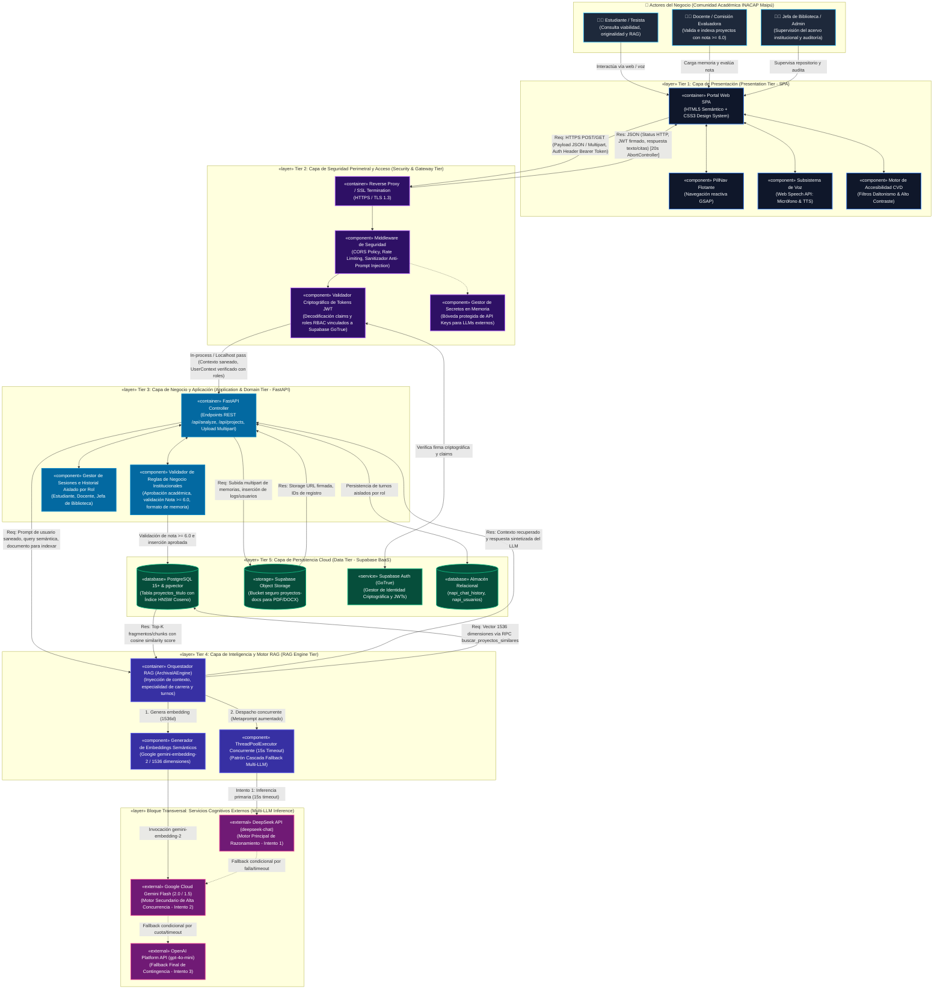

# 01 — Diagrama de Arquitectura Global (Enterprise Architecture / C4 Model)
### *N.A.P.I — Núcleo Académico de Proyectos e Innovación · INACAP Sede Maipú*

El presente documento define la **Arquitectura Global del Sistema** siguiendo el estándar del **Modelo C4 (Nivel 2: Contenedores)** y el marco de capas del **Enterprise Architect (EA)**. La solución está reestructurada formalmente en una **Arquitectura en 5 Tiers + Bloque Transversal de Servicios Cognitivos**, resolviendo la separación estricta entre la **Capa de Seguridad Perimetral / Gateway** y la **Capa de Negocio y Aplicación**, además de definir formalmente todos los contratos y flujos de datos (Request / Response).

---

## 🏛️ Diagrama de Arquitectura Global (C4 Nivel 2: Contenedores / Enterprise Layering)



---

## 🔄 Especificación Exhaustiva de Flujos de Datos (Request / Response)

### 1. Flujo Presentación $\to$ Seguridad/Gateway (Tier 1 $\to$ Tier 2)
- **Protocolo de Transporte:** HTTPS sobre **TLS 1.3**, puertos `443` / `8000`.
- **Estructura del Request:**
  - *Headers:* `Authorization: Bearer <JWT_TOKEN>`, `Content-Type: application/json` o `multipart/form-data`.
  - *Payload:* Objeto `AnalyzeRequest` con propuesta de titulación y especialidad académica, o formulario de subida de proyectos con archivo binario (PDF/DOCX).
- **Estructura del Response:**
  - *Status HTTP:* `200 OK`, `400 Bad Request` (por violación de reglas), `401 Unauthorized` o `403 Forbidden`.
  - *Body:* JSON con diagnóstico contextualizado de NAPI, porcentaje de similitud calculado, nivel de riesgo institucional, tarjetas con metadatos y URLs de descarga directa.
- **Control de Resiliencia en Cliente:** Configuración de `AbortController` fijado en **20 segundos** para amortiguar arranques en frío (*cold starts*) de entornos en la nube sin degradar la experiencia de usuario.

---

### 2. Flujo Seguridad $\to$ Negocio/FastAPI (Tier 2 $\to$ Tier 3)
- **Mecanismo:** Comunicación *In-process* y canal ASGI interno de alto rendimiento.
- **Transformación de Datos:**
  - El middleware de seguridad sanitiza la entrada textual, neutralizando vectores de inyección SQL y patrones maliciosos de *Prompt Injection*.
  - El validador criptográfico decodifica el token JWT emitido por **Supabase GoTrue**, extrayendo claims verificados: `sub` (ID de usuario), `email`, `rol` (`estudiante`, `docente`, `administrador` / `jefa de biblioteca`) y `carrera`.
  - Entrega a los controladores un objeto `UserContext` validado e inmutable.

---

### 3. Flujo Negocio $\to$ Persistencia Cloud (Tier 3 $\to$ Tier 5)
- **Subida de Memorias:**
  - *Request:* Stream binario multipart sanitizado hacia el bucket seguro `proyectos-docs` mediante protocolo compatible con **Amazon S3 REST**.
  - *Response:* URL firmada y metadatos del objeto persistido (`archivo_url`).
- **Persistencia Transaccional y Auditoría:**
  - *Request:* Operaciones DML sobre `napi_chat_history` y `napi_usuarios` a través de conexiones SSL directas a PostgreSQL o REST via Supabase Python SDK.
  - *Response:* Confirmación de inserción con IDs únicos generados (`UUID v4`).

---

### 4. Flujo Negocio $\to$ Capa RAG (Tier 3 $\to$ Tier 4)
- **Invocación:** Método interno `ArchivaIAEngine.analizar_propuesta(...)` ejecutado dentro del ciclo de vida asíncrono de FastAPI.
- **Request:** Cadena textual saneada, umbral de coincidencia coseno (`match_threshold = 0.40`), límite de proyectos afines (`match_count = 4`), carrera de especialidad, e historial conversacional multi-turno.
- **Response:** Contexto estructurado de memorias similares recuperadas y respuesta diagnóstica final sintetizada por el modelo LLM.

---

### 5. Flujo Capa RAG $\to$ PostgreSQL & pgvector (Tier 4 $\to$ Tier 5)
- **Vectorización Previa:** `gemini-embedding-2` calcula el vector denso normalizado de **1536 dimensiones** con directiva `task_type="RETRIEVAL_QUERY"`.
- **Llamada RPC:**
  ```sql
  SELECT * FROM public.buscar_proyectos_similares(
    query_embedding := [0.0124, -0.0451, ..., 0.0892],
    match_threshold := 0.40,
    match_count := 4,
    filtro_carrera := 'Ingeniería en Informática'
  );
  ```
- **Respuesta:** Top-K tuplas ordenadas por proximidad angular en el índice **HNSW** (`vector_cosine_ops`), retornando `id`, `titulo`, `resumen`, `carrera`, `anio`, `autores`, `archivo_url`, `nota` y `similitud` calculada como:
  $$\text{Similitud} = 1 - (\text{embedding} \Leftrightarrow \text{query\_embedding})$$

---

### 6. Flujo Capa RAG $\to$ Servicios Cognitivos Multi-LLM (Tier 4 $\to$ External Tier)
- **Estrategia:** Despacho concurrente desacoplado en `ThreadPoolExecutor` con **timeout estricto de 15 segundos por intento**.
- **Patrón Cascada Fallback:**
  1. **Intento 1 (Principal):** **DeepSeek API** (`deepseek-chat`) — Selección por su alta capacidad de razonamiento técnico y consistencia pedagógica.
  2. **Intento 2 (Fallback Secundario):** **Google Cloud Gemini Flash** (`gemini-2.0-flash` / `1.5-flash`) — Activado automáticamente ante latencia > 15s o error de conectividad.
  3. **Intento 3 (Fallback de Emergencia):** **OpenAI Platform API** (`gpt-4o-mini`) — Activado si la cuota de Gemini se satura, garantizando 99.9% de disponibilidad operativa.

---

## 📋 Catálogo de Componentes por Tier Arquitectónico

| Tier | Componente | Responsabilidad Técnica |
| :--- | :--- | :--- |
| **Tier 1: Presentación** | `SPA_Portal` | Renderizado reactivo SPA en Vanilla JS/CSS3. Consumo asíncrono de la API REST. |
| **Tier 1: Presentación** | `SPA_Nav` | Barra flotante dinámica gestionada con **GSAP** (`PillNav.js`). |
| **Tier 1: Presentación** | `SPA_Voice` | Dictado continuo y síntesis de voz mediante **Web Speech API**. |
| **Tier 1: Presentación** | `SPA_Access` | Filtros dinámicos CSS para accesibilidad universal (Daltonismo CVD y alto contraste). |
| **Tier 2: Seguridad/Gateway** | `GW_ReverseProxy` | Terminación SSL/TLS 1.3, ruteo perimetral y servidor estático. |
| **Tier 2: Seguridad/Gateway** | `GW_SecurityMiddleware` | Políticas CORS, rate limiting y sanitización tipada contra inyecciones de código y prompts. |
| **Tier 2: Seguridad/Gateway** | `GW_TokenValidator` | Decodificación y validación de tokens JWT vinculados con **Supabase GoTrue** y RBAC. |
| **Tier 2: Seguridad/Gateway** | `GW_SecretVault` | Almacenamiento seguro en servidor de llaves maestras (`.env`) sin exposición al cliente. |
| **Tier 3: Negocio/Aplicación**| `APP_FastAPIController` | Controlador REST en FastAPI 3.12 (`server.py`), gestión de endpoints y multipart streams. |
| **Tier 3: Negocio/Aplicación**| `APP_BusinessValidator` | Cumplimiento normativo institucional INACAP: **bloqueo automático de memorias con nota < 6.0**. |
| **Tier 3: Negocio/Aplicación**| `APP_SessionManager` | Aislamiento multi-inquilino de chats e historiales por usuario y rol académico. |
| **Tier 4: Inteligencia RAG** | `RAG_Orchestrator` | Ensamblaje de metaprompts con contexto institucional, carrera y archivos adjuntos. |
| **Tier 4: Inteligencia RAG** | `RAG_Embedder` | Generación de tensores semánticos densos de 1536 dimensiones (`gemini-embedding-2`). |
| **Tier 4: Inteligencia RAG** | `RAG_ThreadPool` | Orquestación concurrente con timeout de 15 segundos y fallback en cascada. |
| **Tier 5: Persistencia Cloud**| `DB_PGVector` | PostgreSQL 15+ con extensión `pgvector` e índice HNSW para búsqueda por coseno en milisegundos. |
| **Tier 5: Persistencia Cloud**| `DB_Storage` | Supabase Object Storage (`proyectos-docs`) con enlaces públicos protegidos para PDF/DOCX. |
| **Tier 5: Persistencia Cloud**| `DB_AuthService` | Emisión y renovación de sesiones de usuario vía Supabase GoTrue Auth. |
| **Tier 5: Persistencia Cloud**| `DB_RelationalStore` | Persistencia relacional de mensajes (`napi_chat_history`) y metadatos de usuario (`napi_usuarios`). |
| **Bloque Transversal Cognitivo**| `EXT_DeepSeek` | Inferencia primaria con modelo de razonamiento profundo `deepseek-chat`. |
| **Bloque Transversal Cognitivo**| `EXT_GeminiFlash` | Inferencia de alta velocidad y concurrencia con `gemini-2.0-flash` / `1.5-flash`. |
| **Bloque Transversal Cognitivo**| `EXT_OpenAI` | Motor de contingencia final con `gpt-4o-mini`. |

---

## ⏱️ Acuerdos de Nivel de Servicio (SLA) y Presupuesto de Timeouts

| Enlace / Operación | Timeout Máximo | Mecanismo de Fallback / Mitigación |
| :--- | :---: | :--- |
| **Cliente $\to$ Gateway (Tier 1 $\to$ Tier 2)** | **20s** | `AbortController` en JavaScript aborta la llamada y presenta feedback amigable sin bloquear la UI. |
| **Intento 1 Multi-LLM (DeepSeek)** | **15s** | El `ThreadPoolExecutor` cancela la espera y activa de inmediato el Intento 2 (Google Gemini). |
| **Intento 2 Multi-LLM (Gemini Flash)** | **15s** | Conmuta automáticamente al Intento 3 (OpenAI GPT-4o-mini) ante fallas de cuota o red. |
| **Búsqueda Vectorial HNSW (pgvector)** | **< 100ms** | Si el cálculo vectorial no responde, se activa búsqueda léxica fallback por palabras clave (`ILIKE`). |
| **Subida de Archivo a Storage S3** | **10s** | Stream directo en trozos (*chunked streaming*) con prefijo UUID para prevenir colisiones de nombres. |
