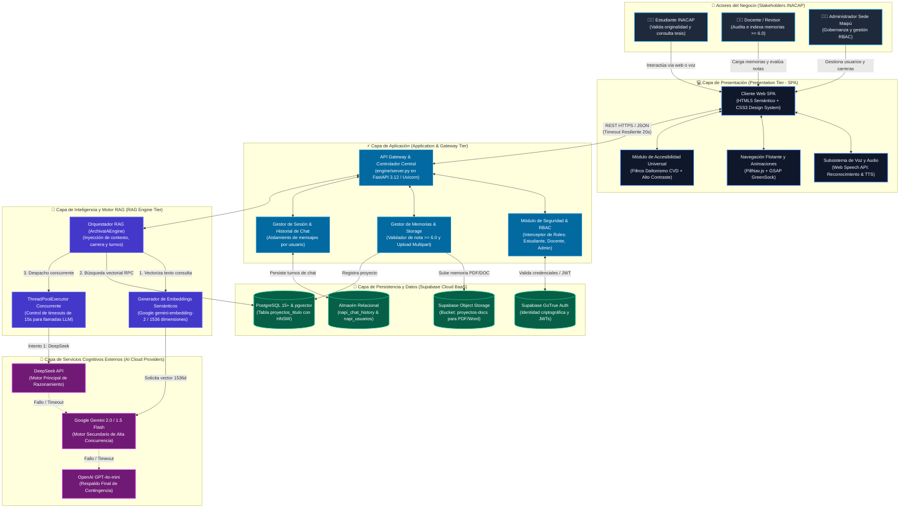

# 01 — Diagrama de Arquitectura Global (Enterprise Architecture / C4 Model)
### *N.A.P.I — Núcleo Académico de Proyectos e Innovación · INACAP Sede Maipú*

El presente documento define la **Arquitectura Global del Sistema** siguiendo el estándar del **Modelo C4 (Nivel 2: Contenedores)** y el marco de capas del **Enterprise Architect (EA)**. La solución está diseñada bajo una arquitectura orientada a servicios desacoplada, optimizada para baja latencia, resiliencia ante arranques en frío (*cold starts*) y precisión semántica en recuperación de información.

---

## 🏛️ Diagrama de Arquitectura en Capas Enterprise

---

## 🔍 Descripción de Capas y Responsabilidades

### 1. Capa de Presentación (Presentation Tier)
- **Portal SPA (Single Page Application):** Construido en HTML5 semántico y CSS3 con variables de diseño personalizadas. No requiere bundlers pesados, logrando una carga instantánea con First Contentful Paint (FCP) inferior a 400 ms.
- **Subsistema de Voz (`Web Speech API`):** Permite entrada por reconocimiento de voz continuo (`webkitSpeechRecognition`) y respuesta por síntesis de voz (`SpeechSynthesisUtterance`) para usuarios con discapacidad motora o preferencia conversacional.
- **Micro-interacciones y UI Flotante:** Implementadas mediante el controlador `PillNav.js` y la biblioteca **GSAP (GreenSock)**, proporcionando una barra de navegación con seguimiento dinámico de secciones.
- **Accesibilidad Universal (CVD):** Modos visuales adaptados para deficiencias de visión del color (Deuteranopia, Protanopia, Tritanopia y Acromatopsia) junto con bordes de alto contraste.

### 2. Capa de Aplicación y API Gateway (Application Tier)
- **FastAPI / Uvicorn Server:** Servidor asíncrono en Python 3.12 que expone endpoints RESTful bajo OpenAPI 3.0.
- **Mapeo de Rutas y Proxy Estático:** Sirve simultáneamente los activos de cliente (`/`, `/css`, `/js`, `/assets`) y los servicios de API (`/api/*`).
- **Control de Acceso Basado en Roles (RBAC):** Restricción jerárquica de operaciones según los perfiles institucionales:
  - `Estudiante`: Solo lectura de proyectos públicos y consulta a NAPI.
  - `Docente`: Capacidad de indexación y carga de documentos con validación de nota $\ge 6.0$.
  - `Administrador`: Auditoría global, CRUD de usuarios e indexación sin restricciones.

### 3. Capa de Lógica de Negocio y Motor RAG (RAG Engine Tier)
- **Vectorización Semántica:** Transforma consultas y memorias en vectores densos de **1536 dimensiones** mediante el modelo `gemini-embedding-2`, configurado con `task_type="RETRIEVAL_QUERY"` para preguntas y `task_type="RETRIEVAL_DOCUMENT"` para documentos.
- **Inyección Contextual Dinámica:** Ensambla prompts enriquecidos con:
  1. Top-K proyectos más afines recuperados por similitud coseno.
  2. Especialidad académica del estudiante (área formativa INACAP).
  3. Extracto de archivos adjuntos (PDF / DOCX / TXT).
  4. Historial conversacional reciente para soporte multi-turno.
- **Cascada de Resiliencia Multi-LLM:**
  1. Intento primario: **DeepSeek Chat API**.
  2. Fallback secundario: **Google Gemini 2.0 / 1.5 Flash**.
  3. Respaldo final: **OpenAI GPT-4o-mini**.
  - Todo orquestado mediante `ThreadPoolExecutor` con **timeout estricto de 15 segundos**.

### 4. Capa de Persistencia y Servicios en la Nube (Data & BaaS Tier)
- **Supabase Cloud (PostgreSQL 15+ con `pgvector`):** Base de datos relacional y vectorial de alto desempeño. El índice **HNSW** (`vector_cosine_ops`) permite búsquedas en sub-segundo incluso con decenas de miles de registros.
- **Supabase Storage:** Bucket S3-compatible (`proyectos-docs`) para almacenamiento seguro de las memorias de titulación con enlaces protegidos según rol.
- **Supabase Auth:** Sistema de autenticación de identidades con tokens criptográficos e integración a la tabla de metadatos `napi_usuarios`.

---

## ⏱️ Presupuesto de Tiempos y Resiliencia (SLA Arquitectónico)

| Nivel de Operación | Límite Máximo (Timeout) | Acción de Contingencia ante Excedente |
| :--- | :--- | :--- |
| **Cliente Web (`app.js`)** | **20 Segundos** | `AbortController` cancela la llamada y despliega mensaje de ayuda sin congelar la interfaz. |
| **Llamada a Modelos LLM** | **15 Segundos** | `ThreadPoolExecutor` interrumpe el intento primario y activa automáticamente el siguiente proveedor en cascada. |
| **Búsqueda Vectorial HNSW** | **100 Milisegundos** | Si falla la conexión RPC vectorial, se activa un fallback inmediato de búsqueda léxica (`ILIKE`) ponderada por palabras clave. |
