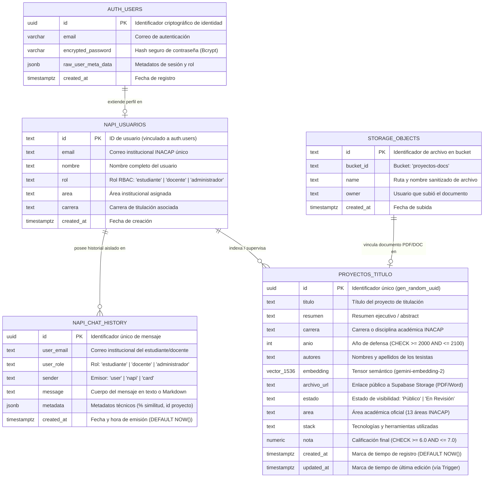

# 03 — Modelo de Datos (Relational & Vectorial ERD Specification)
### *N.A.P.I — Núcleo Académico de Proyectos e Innovación · INACAP Sede Maipú*

El **Modelo de Datos** de N.A.P.I combina un diseño **relacional normalizado** con capacidades de **base de datos vectorial de alta dimensión** provistas por la extensión `pgvector` sobre PostgreSQL 15 en **Supabase**.

---

## 📊 Diagrama Entidad-Relación (ERD) en Notación Crow's Foot



---

## 🗄️ Diccionario de Datos Exhaustivo

### 1. Tabla `public.proyectos_titulo`
Representa el acervo oficial de memorias de título aprobadas por la comisión evaluadora de INACAP Sede Maipú.

| Columna | Tipo de Dato | Nulo | Restricciones / Valor por Defecto | Descripción |
| :--- | :--- | :---: | :--- | :--- |
| `id` | `UUID` | NO | `PRIMARY KEY DEFAULT gen_random_uuid()` | Identificador universal del proyecto. |
| `titulo` | `TEXT` | NO | - | Título formal de la memoria de titulación. |
| `resumen` | `TEXT` | NO | - | Resumen detallado de la problemática, metodología y solución. |
| `carrera` | `TEXT` | NO | - | Carrera técnica o profesional cursada por los estudiantes. |
| `anio` | `INTEGER` | NO | `CHECK (anio >= 2000 AND anio <= 2100)` | Año lectivo en que el proyecto fue sustentado y aprobado. |
| `autores` | `TEXT` | NO | - | Tesistas y desarrolladores autores del proyecto. |
| `embedding` | `VECTOR(1536)` | SÍ | - | Vector denso de características semánticas generado por `gemini-embedding-2`. |
| `archivo_url` | `TEXT` | SÍ | - | URL pública o firmada del archivo PDF/Word en Supabase Storage. |
| `estado` | `TEXT` | SÍ | `DEFAULT 'Público'` | Estado del documento (`Público`, `En Revisión`, `Archivado`). |
| `area` | `TEXT` | SÍ | `DEFAULT 'Informática, Ciberseguridad...'` | Una de las 13 áreas académicas oficiales de INACAP. |
| `stack` | `TEXT` | SÍ | - | Tecnologías clave empleadas (ej. Python, ESP32, Docker, Next.js). |
| `nota` | `NUMERIC(3,1)` | SÍ | `CHECK (nota >= 6.0 AND nota <= 7.0)` | **Regla Académica:** Solo se admiten proyectos de excelencia ($\ge 6.0$). |
| `created_at` | `TIMESTAMPTZ` | NO | `DEFAULT NOW()` | Fecha y hora en que se indexó el registro. |
| `updated_at` | `TIMESTAMPTZ` | NO | `DEFAULT NOW()` | Actualizada automáticamente mediante trigger PostgreSQL. |

---

### 2. Tabla `public.napi_chat_history`
Almacena el histórico de diálogo entre los usuarios y el agente conversacional NAPI, garantizando aislamiento estricto por usuario y rol.

| Columna | Tipo de Dato | Nulo | Restricciones / Valor por Defecto | Descripción |
| :--- | :--- | :---: | :--- | :--- |
| `id` | `UUID` | NO | `PRIMARY KEY DEFAULT gen_random_uuid()` | Clave primaria del mensaje. |
| `user_email` | `TEXT` | NO | - | Correo institucional del alumno o docente emisor. |
| `user_role` | `TEXT` | NO | `DEFAULT 'estudiante'` | Rol del usuario (`estudiante`, `docente`, `administrador`). |
| `sender` | `TEXT` | NO | - | Identificador del emisor (`user`, `napi`, `card`). |
| `message` | `TEXT` | NO | - | Contenido textual del mensaje o respuesta estructurada. |
| `metadata` | `JSONB` | SÍ | `DEFAULT '{}'::jsonb` | Atributos adicionales (proyectos citados, % similitud, archivos evaluados). |
| `created_at` | `TIMESTAMPTZ` | NO | `DEFAULT NOW()` | Marca de tiempo del mensaje para orden cronológico. |

---

### 3. Tabla `public.napi_usuarios`
Almacén auxiliar sincronizado con `auth.users` para facilitar consultas administrativas y agrupamiento por carreras.

| Columna | Tipo de Dato | Nulo | Restricciones / Valor por Defecto | Descripción |
| :--- | :--- | :---: | :--- | :--- |
| `id` | `TEXT` | NO | `PRIMARY KEY` | Clave primaria vinculada a la cuenta de autenticación. |
| `email` | `TEXT` | NO | `UNIQUE` | Correo institucional del usuario. |
| `nombre` | `TEXT` | NO | - | Nombre y apellido del usuario. |
| `rol` | `TEXT` | NO | `DEFAULT 'estudiante'` | Nivel de permisos RBAC asignado. |
| `area` | `TEXT` | SÍ | - | Área académica institucional de pertenencia. |
| `carrera` | `TEXT` | SÍ | - | Carrera específica del estudiante o departamento docente. |
| `created_at` | `TIMESTAMPTZ` | NO | `DEFAULT NOW()` | Fecha de registro en la plataforma. |

---

## ⚡ Estrategia de Indexación y Rendimiento

### 1. Índice Vectorial HNSW (Hierarchical Navigable Small World)
Para posibilitar búsquedas vectoriales sobre la columna `embedding` sin penalización por volumen de datos:

```sql
CREATE INDEX idx_proyectos_embedding_hnsw
  ON public.proyectos_titulo
  USING hnsw (embedding vector_cosine_ops)
  WITH (m = 16, ef_construction = 64);
```
- **Métrica:** `vector_cosine_ops` calcula la distancia coseno:
  $$\text{Distancia Coseno}(\vec{u}, \vec{v}) = 1 - \frac{\vec{u} \cdot \vec{v}}{\|\vec{u}\| \|\vec{v}\|}$$
  $$\text{Similitud} = 1 - \text{Distancia Coseno}$$
- **Parámetro $M = 16$:** Número de conexiones bidireccionales por nodo del grafo. Balance óptimo entre consumo de RAM y precisión.
- **Parámetro $ef\_construction = 64$:** Tamaño de la lista de vecinos explorada durante la construcción del índice.

> **Justificación de las 1536 Dimensiones:**
> El modelo `gemini-embedding-2` de Google genera vectores de hasta 3072 dimensiones. Sin embargo, los índices HNSW en `pgvector` tienen un límite técnico de **2000 dimensiones**. Al configurar `output_dimensionality = 1536`, se preserva la máxima densidad semántica del modelo y se garantiza compatibilidad total y alto rendimiento con el motor de índices HNSW.

### 2. Índices B-Tree Relacionales
```sql
-- Optimiza la consulta y limpieza del historial conversacional por usuario y rol
CREATE INDEX idx_napi_chat_user 
  ON public.napi_chat_history (user_email, user_role, created_at);

-- Optimiza la búsqueda de proyectos por año lectivo
CREATE INDEX idx_proyectos_anio 
  ON public.proyectos_titulo (anio DESC);
```

---

## 🧩 Procedimiento Almacenado RPC: `buscar_proyectos_similares`

```sql
CREATE OR REPLACE FUNCTION public.buscar_proyectos_similares(
  query_embedding  VECTOR(1536),
  match_threshold  FLOAT   DEFAULT 0.40,
  match_count      INT     DEFAULT 4,
  filtro_carrera   TEXT    DEFAULT NULL
)
RETURNS TABLE (
  id          UUID,
  titulo      TEXT,
  resumen     TEXT,
  carrera     TEXT,
  anio        INT,
  autores     TEXT,
  similitud   FLOAT
)
LANGUAGE plpgsql
SECURITY DEFINER
SET search_path = public
AS $$
BEGIN
  RETURN QUERY
  SELECT
    p.id,
    p.titulo,
    p.resumen,
    p.carrera,
    p.anio,
    p.autores,
    (1 - (p.embedding <=> query_embedding))::FLOAT AS similitud
  FROM public.proyectos_titulo p
  WHERE
    (filtro_carrera IS NULL OR p.carrera ILIKE '%' || filtro_carrera || '%')
    AND (1 - (p.embedding <=> query_embedding)) >= match_threshold
  ORDER BY
    p.embedding <=> query_embedding ASC
  LIMIT match_count;
END;
$$;
```

---

## 🔒 Políticas de Seguridad a Nivel de Fila (Row Level Security - RLS)

1. **Tabla `proyectos_titulo`:**
   - **SELECT:** Acceso público de lectura a todos los usuarios para alimentar el catálogo institucional y el motor RAG.
   - **INSERT / UPDATE / DELETE:** Exclusivo para el rol `service_role` ejecutado desde el backend autenticado de FastAPI, garantizando que ninguna inserción burle la validación de nota $\ge 6.0$.

2. **Tabla `napi_chat_history`:**
   - Acceso granular por correo institucional y rol de sesión para proteger la privacidad de las ideas de titulación de los alumnos.
