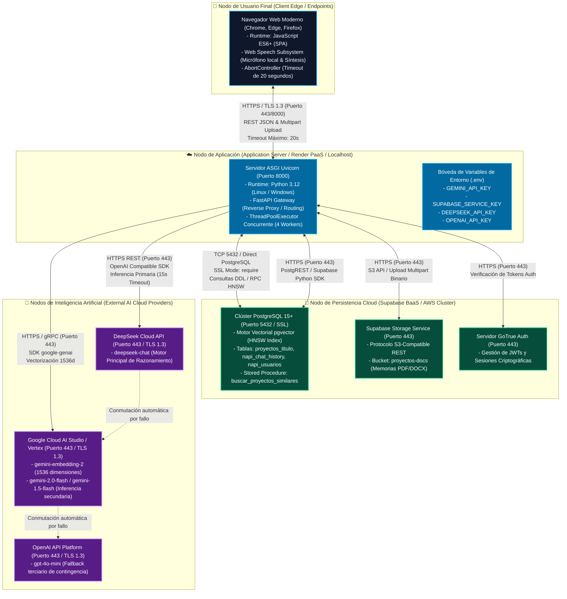

# 04 — Topología de Comunicación y Red (Deployment & Network Architecture)
### *N.A.P.I — Núcleo Académico de Proyectos e Innovación · INACAP Sede Maipú*

La **Topología de Comunicación y Red** describe los nodos computacionales físicos y virtuales que componen la infraestructura de N.A.P.I, los canales de interconexión, los protocolos de transporte, los puertos involucrados y las fronteras de seguridad de red (**DMZ**, entornos seguros de backend y servicios gestionados en la nube).

---

## 🌐 Diagrama de Topología de Red y Despliegue Físico/Lógico

---

## 📊 Matriz de Comunicaciones y Protocolos de Red

| Flujo / Canal | Origen | Destino | Protocolo / Transporte | Puerto | Formato Payload | Autenticación | SLA / Timeout |
| :--- | :--- | :--- | :--- | :---: | :--- | :--- | :---: |
| **C1: Interacción de Usuario** | Navegador Web | Servidor FastAPI | **HTTPS / TLS 1.3** | `443` / `8000` | JSON / Form-Data | Bearer Token / Cookie | 20s (`AbortController`) |
| **C2: Audio y Reconocimiento** | Micrófono Usuario | Motor Web Speech | **Internal OS API** | N/A | PCM Audio Stream | Permiso de Navegador | Inmediato |
| **C3: Vectorización Semántica** | Servidor FastAPI | Google AI Studio | **HTTPS / REST** | `443` | JSON (Texto $\to$ 1536d) | `GEMINI_API_KEY` | 3s |
| **C4: Búsqueda Vectorial HNSW** | Servidor FastAPI | PostgreSQL Supabase | **Direct PostgreSQL / TLS** | `5432` | Binary pgvector RPC | `SUPABASE_SERVICE_KEY` | < 100 ms |
| **C5: Inferencia LLM Primaria** | Servidor FastAPI | DeepSeek API | **HTTPS / REST** | `443` | JSON (Chat Completions) | `DEEPSEEK_API_KEY` | 15s (`ThreadPool`) |
| **C6: Fallback Inferencia Sec.** | Servidor FastAPI | Google Gemini API | **HTTPS / gRPC** | `443` | JSON (Generate Content) | `GEMINI_API_KEY` | 15s (`ThreadPool`) |
| **C7: Fallback Terciario** | Servidor FastAPI | OpenAI API | **HTTPS / REST** | `443` | JSON (Chat Completions) | `OPENAI_API_KEY` | 15s (`ThreadPool`) |
| **C8: Subida de Memorias PDF** | Servidor FastAPI | Supabase Storage | **HTTPS / S3 REST** | `443` | Binary Multipart Stream | `service_role` Secret | 10s |
| **C9: Historial Multi-Inquilino**| Servidor FastAPI | PostgreSQL Supabase | **HTTPS / PostgREST** | `443` | JSON (Insert / Select) | `SUPABASE_ANON_KEY` | 500 ms |

---

## 🛡️ Zonas de Seguridad y Políticas de Protección Perimetral

### 1. Perímetro de Cliente (Untrusted Edge)
- Todo el código JavaScript en el navegador del usuario se ejecuta en el espacio de aislamiento del navegador (*sandbox*).
- **Cero Exposición de Secretos:** El cliente **nunca** posee las llaves maestras de Gemini, OpenAI, DeepSeek o la `service_role` de Supabase. Cualquier transacción privilegiada viaja obligatoriamente a través del servidor FastAPI.

### 2. Zona DMZ / Servidor de Aplicación (Application Perimeter)
- **FastAPI** actúa como barrera de sanitización y cortafuegos de aplicación.
- Políticas de **CORS** explícitas para permitir consumo controlado.
- Validación de esquemas y tipos en tiempo de compilación/ejecución mediante **Pydantic**.
- Inyección de variables de entorno mediante archivos locales protegidos con permisos de lectura restringidos (`chmod 600` en producción).

### 3. Zona Privada de Persistencia (Secure Cloud BaaS)
- Acceso directo a base de datos cifrado mediante **SSL/TLS**.
- Activación de **Row Level Security (RLS)** en PostgreSQL: aunque un usuario malicioso interceptase la clave anónima (`SUPABASE_ANON_KEY`), no puede alterar proyectos aprobados ni manipular calificaciones.
- La inserción de proyectos está reservada al canal autenticado con la llave `SUPABASE_SERVICE_KEY`.

---

## ⚡ Mitigación de Arranques en Frío (*Cold Starts*) y Latencia

Al desplegar en plataformas cloud con contenedores que se suspenden por inactividad (como la capa gratuita de Render):
1. **Margen Resiliente de 20 Segundos en Frontend:** El cliente (`app.js`) configura el `AbortController` con una ventana de tolerancia de 20.000 ms, evitando que un arranque en frío de 8 a 12 segundos corte la experiencia del estudiante.
2. **Caché en Memoria de Proyectos:** El catálogo público almacena en caché local (`sessionStorage`) los proyectos consultados para reducir solicitudes redundantes a la base de datos durante la navegación activa.
3. **Manejo de Errores con Degradación Elegante:** Si la búsqueda semántica vectorial experimenta demoras o micro-cortes, el sistema conmuta automáticamente a una búsqueda léxica SQL ponderada en milisegundos, retornando resultados sin interrumpir la sesión del usuario.
