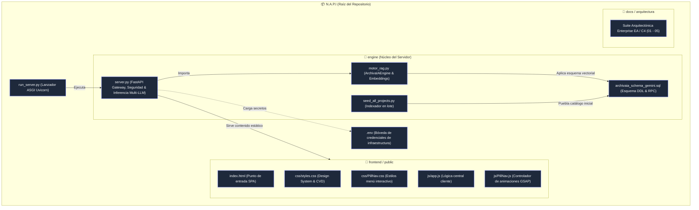
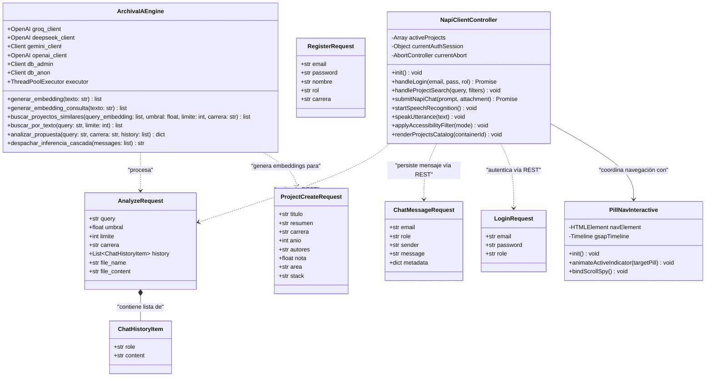

# 05 — Diagrama de Estructura y Clases (Composite Structure & Package Architecture)
### *N.A.P.I — Núcleo Académico de Proyectos e Innovación · INACAP Sede Maipú*

El **Diagrama de Estructura** modela la organización estática interna del software, incluyendo la arquitectura de paquetes, el diagrama de clases UML con sus atributos, métodos y visibilidad, así como los **Objetos de Transferencia de Datos (DTOs)** implementados con **Pydantic V2**.

---

## 🏗️ Diagrama de Paquetes (Package Diagram)

---

## 📐 Diagrama de Clases UML y DTOs (Class Diagram)

---

## 🔍 Detalle de Componentes y Clases Backend

### 1. Clase `ArchivaIAEngine` (`engine/motor_rag.py` & `engine/server.py`)
Encapsula la lógica de inteligencia artificial y recuperación semántica de la plataforma:
- `generar_embedding(texto: str) -> list`: Limpia y envía el texto de una memoria a Google AI Studio (`gemini-embedding-2`) con la tarea `RETRIEVAL_DOCUMENT`, retornando el vector denso truncado a **1536 dimensiones**.
- `generar_embedding_consulta(texto: str) -> list`: Vectoriza la duda o anteproyecto del estudiante con la tarea `RETRIEVAL_QUERY`.
- `buscar_proyectos_similares(...) -> list`: Ejecuta la función RPC de PostgreSQL `buscar_proyectos_similares` en Supabase y retorna las coincidencias ordenadas por distancia coseno con `archivo_url` para descarga.
- `buscar_por_texto(...) -> list`: Mecanismo de resiliencia (fallback léxico) que aplica coincidencia mediante cláusulas `ILIKE` cuando los servicios vectoriales no están disponibles.
- `despachar_inferencia_cascada(messages) -> str`: Despacha secuencialmente las consultas entre **Groq LPU**, **DeepSeek**, **Google Gemini** y **OpenAI** mediante un `ThreadPoolExecutor` con límite de 15 segundos por intento.

---

### 2. Contratos de Datos (Modelos Pydantic en `engine/server.py`)
Garantizan la tipificación estricta en tiempo de ejecución, impidiendo vulnerabilidades de inyección y asegurando la integridad de las peticiones HTTP:

- **`AnalyzeRequest`**: Encapsula la consulta del estudiante, el umbral de similitud mínima, el límite de proyectos afines a contrastar, la carrera disciplinar para enfocar la innovación, el historial de turnos previos y el contenido de archivos adjuntos (PDF / DOCX / TXT).
- **`ProjectCreateRequest`**: Valida que cada memoria cargada incluya título, resumen, carrera, autores, año lectivo y la nota de titulación. La lógica del servidor verifica obligatoriamente que `nota >= 6.0`.
- **`ChatMessageRequest`**: Estructura el almacenamiento del diálogo en la tabla `napi_chat_history`, asociando al emisor con su correo institucional y rol.
- **`LoginRequest` / `RegisterRequest`**: Modelan la autenticación y registro de docentes y estudiantes en **Supabase Auth (GoTrue)**.

---

## 💻 Controladores del Lado del Cliente (Frontend MVC)

### 1. `NapiClientController` (`js/app.js`)
Actúa como el cerebro del lado del cliente bajo un patrón Modelo-Vista-Controlador (MVC) reactivo ligero:
- **Gestor de Sesión:** Administra el estado de autenticación en `localStorage` o `sessionStorage`, habilitando dinámicamente las vistas según el perfil (Estudiante, Docente o Administrador).
- **Controlador Conversacional NAPI:** Maneja el ciclo de vida del chat, la renderización de Markdown, la inserción de tarjetas interactivas de proyectos similares y el control de cancelación por timeout mediante `AbortController` (20 segundos).
- **Subsistema de Voz Bidireccional:** Integra `webkitSpeechRecognition` para dictado por voz y `window.speechSynthesis` con voces en español para locución asistida.
- **Gestor de Accesibilidad CVD:** Aplica filtros CSS en tiempo real en la raíz del documento para usuarios con Deuteranopia, Protanopia, Tritanopia y Acromatopsia.

### 2. `PillNavInteractive` (`js/PillNav.js`)
Controlador especializado en la experiencia visual:
- Emplea **GSAP (GreenSock)** para crear una píldora flotante animada que sigue la navegación del usuario con interpolaciones elásticas (*spring physics*).
- Implementa observadores de intersección (*IntersectionObserver*) para sincronizar automáticamente la sección activa de la pantalla con el indicador de la barra.
