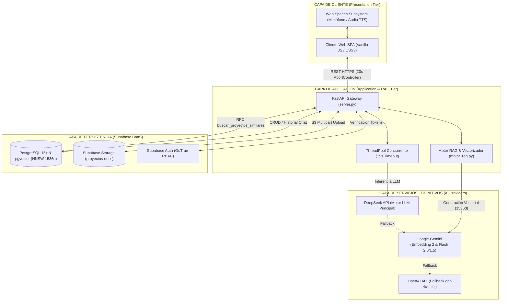

# N.A.P.I — Arquitectura de Software Enterprise
### *Núcleo Académico de Proyectos e Innovación · INACAP Sede Maipú (2026)*

Bienvenido al repositorio de diseño y arquitectura de software de **N.A.P.I**. Esta suite documental modela integralmente el sistema bajo estándares de la industria (equivalentes a especificaciones generadas en **Sparx Systems Enterprise Architect**, **TOGAF** y el modelo **C4 / UML 2.5**).

---

## 📑 Índice de Especificaciones Arquitectónicas

Los artefactos se dividen en 5 dimensiones fundamentales de la ingeniería de software:

1. [🏛️ **Diagrama de Arquitectura Global**](01_diagrama_arquitectura.md)
   - Vista C4 de Contenedores y Capas Enterprise (Presentación, Gateway, Lógica RAG, Persistencia, Cognitive Services).
   - Flujo de interacción extremo a extremo y políticas de desacoplamiento.

2. [🧩 **Diagrama de Componentes (UML 2.5)**](02_diagrama_componentes.md)
   - Especificación formal de subsistemas, puertos, interfaces provistas e interfaces requeridas (Lollipop & Socket).
   - Desglose de componentes frontend, middleware FastAPI, motor semántico y conectores cloud.

3. [📊 **Modelo de Datos y Repositorio Vectorial**](03_modelo_datos.md)
   - Diagrama Entidad-Relación (ERD) en notación Crow's Foot.
   - Modelo Híbrido Relacional + Vectorial (`pgvector` 1536 dimensiones e índice HNSW).
   - Diccionario de datos exhaustivo, procedimientos almacenados (RPC), triggers y políticas RLS.

4. [🌐 **Topología de Comunicación y Red**](04_topologia_comunicacion.md)
   - Topología de despliegue físico y lógico en entornos cliente, servidor y nube.
   - Matriz de protocolos (HTTPS, REST, Web Speech, S3 Storage API, Direct PostgreSQL).
   - Perímetros de seguridad DMZ, gestión de latencias y presupuestos de timeout.

5. [🏗️ **Diagrama de Estructura y Clases**](05_diagrama_estructura.md)
   - Diagrama de Estructura Compuesta y Diagrama de Paquetes.
   - Jerarquía de clases backend (DTOs Pydantic, `ArchivaIAEngine`, enrutadores) y controladores frontend (MVC / SPA).

---

## 🎯 Resumen Ejecutivo de la Arquitectura

---

## 📌 Guía de Trazabilidad con el Código Fuente

| Componente Arquitectónico | Implementación en Repositorio | Función Principal |
| :--- | :--- | :--- |
| **API Gateway & RAG Routing** | `engine/server.py` | Exposición REST, inyección de contexto y control de timeouts. |
| **Motor Vectorial y Embeddings** | `engine/motor_rag.py` | Generación de tensores de 1536 dimensiones y fallback semántico. |
| **Población & Indexación Inicial** | `engine/seed_all_projects.py` | Vectorización en lote del catálogo histórico de INACAP Maipú. |
| **Esquema DDL & Procedimientos RPC** | `engine/archivaia_schema_gemini.sql` | Definición de tablas, índices HNSW e índices relacionales en PostgreSQL. |
| **Frontend SPA y Controladores** | `js/app.js` | Estado de la aplicación, interacción por voz, renderizado y RBAC. |
| **Controlador de Navegación** | `js/PillNav.js` | Animaciones dinámicas de interfaz con GSAP. |
| **Punto de Entrada del Servidor** | `run_server.py` | Servidor ASGI Uvicorn para despliegue local y en producción (Render). |
