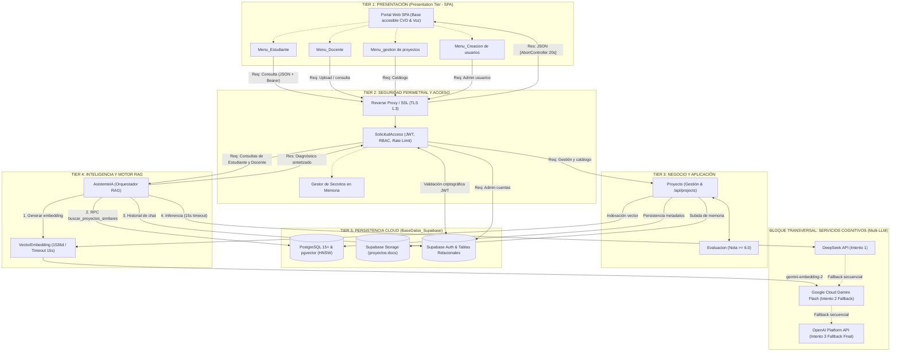

# N.A.P.I — Arquitectura de Software Enterprise
### *Núcleo Académico de Proyectos e Innovación · INACAP Sede Maipú (2026)*

Bienvenido al repositorio de diseño y arquitectura de software de **N.A.P.I**. Esta suite documental modela integralmente el sistema bajo estándares de la industria (equivalentes a especificaciones generadas en **Sparx Systems Enterprise Architect**, **TOGAF** y el modelo **C4 / UML 2.5**).

---

## 🏛️ Patrón Arquitectónico del Sistema: Arquitectura en 5 Tiers + Bloque Transversal

El sistema está estructurado formalmente bajo el patrón de **Arquitectura en Capas (Layered / N-Tier Architecture)** sobre un modelo **Cliente-Servidor (Client-Server)** desacoplado, separando estrictamente la seguridad perimetral de la lógica de dominio:

```
┌────────────────────────────────────────────────────────────────────────────────────────┐
│  TIER 1: CAPA DE PRESENTACIÓN (SPA HTML5 / CSS3 / Accesibilidad CVD y Voz)             │
│  • Menu_Estudiante            • Menu_Docente                                           │
│  • Menu_gestion de proyectos  • Menu_Creacion de usuarios                              │
└───────────────────────────────────────────┬────────────────────────────────────────────┘
                                            │ Req: HTTPS POST/GET (JSON/Multipart, Bearer JWT)
                                            │ Res: JSON (Status, JWT, Diagnóstico) [AbortController 20s]
┌───────────────────────────────────────────▼────────────────────────────────────────────┐
│  TIER 2: SEGURIDAD PERIMETRAL Y ACCESO (Security & Gateway Tier)                       │
│  • Reverse Proxy / SSL (TLS 1.3)   • Gestor de Secretos en Memoria (.env Vault)        │
│  • SolicitudAcceso (Sesiones, Validación JWT, RBAC, Rate Limiting)                     │
└───────────────────────────────────────────┬────────────────────────────────────────────┘
                                            │ Req: Peticiones validadas con UserContext
             ┌──────────────────────────────┴──────────────────────────────┐
             │                                                             │
┌────────────▼───────────────────────────────────────────┐ ┌───────────────▼────────────────────────────┐
│ TIER 3: NEGOCIO Y APLICACIÓN (Domain Tier - FastAPI)   │ │ TIER 4: INTELIGENCIA Y MOTOR RAG            │
│ • Proyecto (/api/projects, metadata, upload)           │ │ (RAG Engine Tier)                           │
│ • Evaluacion (Validación institucional Nota >= 6.0)    │ │ • AsistenteIA (Orquestador RAG)             │
└────────────────────────────┬───────────────────────────┘ │ • VectorEmbedding (gemini-embedding-2 1536d)│
                             │ Upload S3 / Insert DDL      └───────────────┬─────────────────────────────┘
                             │                             ┌───────────────┘ RPC HNSW Coseno
┌────────────────────────────▼─────────────────────────────▼─────────────────────────────┐
│ TIER 5: PERSISTENCIA CLOUD (Data Tier - BaseDatos_Supabase)                            │
│ • PostgreSQL 15+ & pgvector (Índice HNSW Coseno para VectorEmbedding)                 │
│ • Supabase Storage (Bucket proyectos-docs para componente Proyecto)                    │
│ • Supabase Auth & Tablas Relacionales (Para SolicitudAcceso e historial de chat)       │
└──────────────────────────────────────────────────────────┬─────────────────────────────┘
                                                           │
┌──────────────────────────────────────────────────────────▼─────────────────────────────┐
│ BLOQUE TRANSVERSAL: SERVICIOS COGNITIVOS EXTERNOS (Multi-LLM Fallback)                 │
│ • Intento 1: DeepSeek API (deepseek-chat) [Timeout 15s]                                │
│ • Intento 2: Google Cloud Gemini Flash (2.0 / 1.5) [Fallback Secuencial]               │
│ • Intento 3: OpenAI Platform API (gpt-4o-mini) [Fallback Final]                        │
└────────────────────────────────────────────────────────────────────────────────────────┘
```

---

## 📑 Índice de Especificaciones Arquitectónicas

Los artefactos se dividen en 5 dimensiones fundamentales de la ingeniería de software:

1. [🏛️ **01 — Diagrama de Arquitectura Global**](01_diagrama_arquitectura.md)
   - Vista C4 de Contenedores y Capas Enterprise con correspondencia 1:1 estricta con **Enterprise Architect (EA)**.
   - Modelo en 5 Tiers + Bloque Transversal con los componentes exactos de EA (`SolicitudAcceso`, `Proyecto`, `Evaluacion`, `AsistenteIA`, `VectorEmbedding`, `BaseDatos_Supabase`).
   - Políticas de desacoplamiento, resiliencia y SLA de timeouts.

2. [🧩 **02 — Diagrama de Componentes (UML 2.5)**](02_diagrama_componentes.md)
   - Especificación formal de subsistemas, puertos, interfaces provistas e interfaces requeridas (Lollipop & Socket).
   - Componentes perimetrales de seguridad (CORS, JWT GoTrue, RBAC, Pydantic V2, Secret Vault).
   - Desglose de conectores cloud: Groq LPU, DeepSeek, Gemini, OpenAI y Supabase BaaS.

3. [📊 **03 — Modelo de Datos y Repositorio Vectorial**](03_modelo_datos.md)
   - Diagrama Entidad-Relación (ERD) en notación Crow's Foot.
   - Modelo Híbrido Relacional + Vectorial (`pgvector` 1536 dimensiones e índice HNSW `vector_cosine_ops`).
   - Diccionario de datos exhaustivo, procedimiento almacenado RPC `buscar_proyectos_similares`, triggers y políticas de seguridad a nivel de fila (RLS).

4. [🌐 **04 — Topología de Comunicación y Red**](04_topologia_comunicacion.md)
   - Topología de despliegue físico y lógico en entornos cliente, DMZ y nube.
   - Matriz de protocolos de transporte (HTTPS, TLS 1.3, S3 Storage API, Direct PostgreSQL SSL).
   - Nodos de inferencia con SLA de timeouts y amortiguación de arranques en frío (*cold starts*).

5. [🏗️ **05 — Diagrama de Estructura y Clases**](05_diagrama_estructura.md)
   - Diagrama de Estructura Compuesta y Diagrama de Paquetes.
   - Jerarquía de clases backend (DTOs Pydantic tipados, `ArchivaIAEngine`, enrutadores) y controladores frontend SPA (`NapiClientController`, `PillNavInteractive`).

---

## 🎯 Resumen Ejecutivo de la Arquitectura



---

## 📌 Guía de Trazabilidad con el Código Fuente

| Componente Arquitectónico | Implementación en Repositorio | Función Principal |
| :--- | :--- | :--- |
| **API Gateway & RAG Routing** | `engine/server.py` | Exposición REST, inyección de contexto y control de timeouts. |
| **Capa de Seguridad & RBAC** | `engine/server.py` | Control perimetral, tokens GoTrue, validación Pydantic y filtro de nota $\ge 6.0$. |
| **Motor Vectorial y Embeddings** | `engine/motor_rag.py` | Generación de tensores de 1536 dimensiones y fallback semántico. |
| **Población & Indexación Inicial** | `engine/seed_all_projects.py` | Vectorización en lote del catálogo histórico de INACAP Maipú. |
| **Esquema DDL & Procedimientos RPC** | `engine/archivaia_schema_gemini.sql` | Definición de tablas, índices HNSW e índices relacionales en PostgreSQL. |
| **Frontend SPA y Controladores** | `js/app.js` | Estado de la aplicación, interacción por voz, renderizado y RBAC. |
| **Controlador de Navegación** | `js/PillNav.js` | Animaciones dinámicas de interfaz con GSAP. |
| **Punto de Entrada del Servidor** | `run_server.py` | Servidor ASGI Uvicorn para despliegue local y en producción (Render). |
